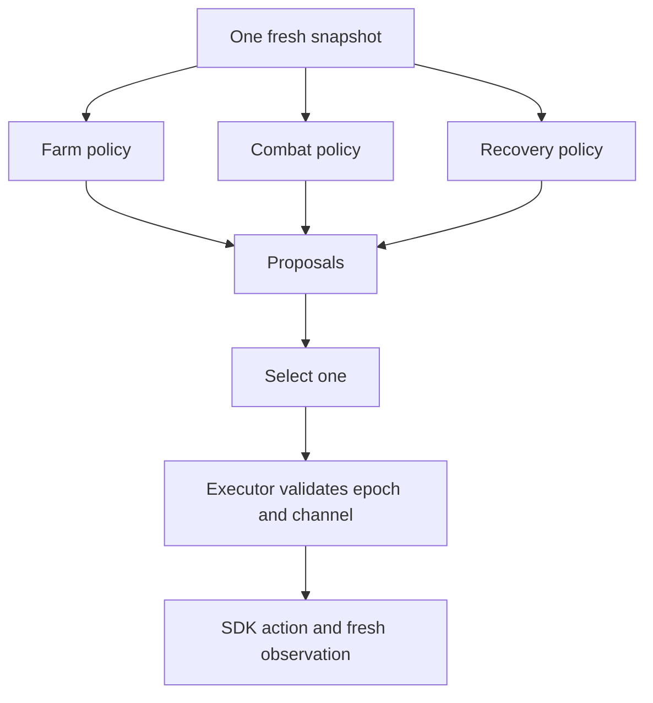

# Adding a policy

Each policy owns a file under `src/policies/`. Start from `hold.h`; register the
function in `registry.h` with a stable tactic ID and name. Add a regression in
`tests/planner.cpp` (and an engine/guest scenario for a new SDK action).

`Policy::propose(const PlanningContext&)` returns `nullopt` when inapplicable, otherwise
a `Proposal` containing a request with the supplied epoch and a shared priority:

| Higher priority wins | Meaning |
| --- | --- |
| `deciding` | Feasible delivery/protection that decides the result |
| `survival` | Required escape/protection under the tactic's feasibility rules |
| `continue_job` | Still-useful existing mission |
| `ordinary` | New productive work |
| `fallback` | Hold when nothing else is enabled |

Equal priorities use lexicographic policy ID, **not registration order**. This is
a reproducible placeholder, not an optimized utility model. A policy must justify
its priority in its tactic and tests. The full resource-cycle feasibility, leases
and utility comparison remain planned; this selector does not implement them.

Policy functions are bounded, deterministic and free of SDK calls or mutations.
They may read only the supplied context. `context.actor` is the cheap action
snapshot. Add observed world/mission views to `PlanningContext` through a reviewed
perception change; keep `SdkPort::read()` small so every action does not rescan
the world. Do not query replay-only or hidden state.
At most 16 policies run per selection; measure fuel before increasing the bound.
Only `hold` is enabled. No combat, farming or automatic channel cancellation is
supplied. The selector skips policies while dead or channeling. Invalid/duplicate
registrations and thrown policy errors are faults; stale proposals abort selection.
The executor rechecks the epoch before acting, including after fuel suspension.

Coordinate the few lines in `registry.h`; keep implementations in separate files.
Until PR #38 merges, make task branches **from** `fran/foundation-baseline` and
set each task PR's **base branch** to `fran/foundation-baseline`. After #38 merges,
use updated `main` as both the starting point and PR base. One teammate reviews
the tactic, interface and checks before merging; GitHub review enforcement has
not been configured by this PR.
