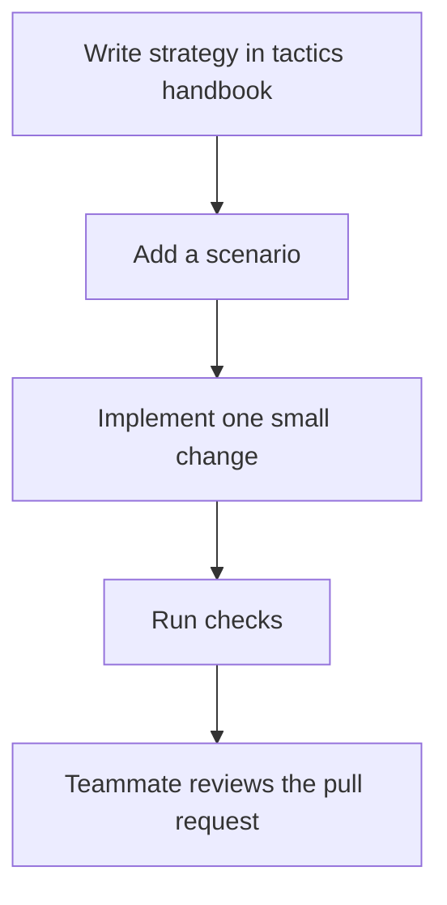

# Foundation: human quick start

This is the new bot's foundation. It currently **holds position**; keep using the
existing competition bot. All new code, comments and documentation use English.



**Start:** switch to branch `fran/foundation-baseline` on GitHub and open
`bots/foundation`. For a local checkout, install Python 3.12+, Node 24 and a C++20
compiler, then run from the repository root:

```sh
git switch fran/foundation-baseline
pip install cambc==2.2.5
cambc init --yes
python bots/foundation/check.py
```

On Windows with wasi-sdk, add `--wasi-cxx <path/to/clang++.exe>` to the check.
Optional overrides: `--cli <path>` and `--engine <path>`. Missing inputs fail;
the engine must match the pinned official 0.0.3 build.

**Make a change:** create your own branch from the foundation branch. Write the
trigger, action, abort rule, fallback and expected result in the relevant
[tactic](../../docs/tactics/README.md), keeping its topic ID. Add a failing scenario,
implement it, run the check, then open a PR linking the tactic and results.
Competitive changes also pass the [team harness](../../harness/README.md).
Before PR #38 merges, target task PRs at `fran/foundation-baseline`; afterward use `main`.

**Find things:** `src/policies/` = separate policy files and registry;
`src/planner.h` = selects one proposal; `src/actions.h` = executor;
`src/sdk_actions.h` = SDK adapter; `tests/` = scenarios;
`out/foundation/checks.json` = generated evidence. Existing bot sources are frozen
by `baseline.json`; the live upload is unverified.

**Four work areas:** runtime/adapters, cycle/navigation, combat, evaluation.
Agree shared interfaces before splitting work; a teammate reviews every PR.
Read [how to add a policy](INTEGRATION.md) and the [review/Carson comparison](REVIEW.md).
Next: full mission logic from the [decision contract](../../docs/tactics/cycle-decision-contract.md),
then policies from the [clean v53 reference](https://github.com/Javiops/Cambridge-Battlecode-2026/tree/990046182a6d001b0b35b91ee58cd8e4145b753b/bots/v53_refactor).

**Using an assistant?** Ask Codex to read [AGENTS.md](../../AGENTS.md), or Claude
to read [CLAUDE.md](../../CLAUDE.md), before making changes.
