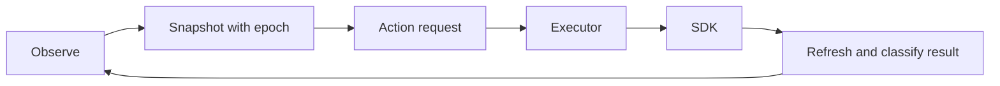

# Bot foundation

PR1 provides action contracts and reproducible checks. The new bot **holds position**;
competitive strategies will be migrated in later PRs. Keep using the existing bot for competition.



**Run** — Python 3.12+, Node 24, and a C++20 compiler:

```sh
pip install cambc==2.2.5
cambc init --yes
python bots/foundation/check.py
```

Windows with wasi-sdk: add `--wasi-cxx <path/to/clang++.exe>`.
Use `--cli <path>` or `--engine <path>` when needed. The check requires the pinned
official 0.0.3 engine; missing inputs fail. Evidence goes to `out/foundation/checks.json`.

**Change** — one idea, one branch, one reviewed PR:

1. Write the trigger, proposed work, abort rule, fallback and expected result in the
   relevant [tactic](../../docs/tactics/README.md); keep its stable topic ID.
2. Add a failing scenario, then implement the smallest change under `bots/foundation`.
3. Use `Executor::observe()` to obtain a fresh epoch; submit requests through
   `Executor::execute()`. Inspect the named outcome and refresh before the next request.
4. Run the check. Link the tactic, test and results in the PR. Competitive changes
   also pass the [team harness](../../harness/README.md).

**Rules** — only `sdk_actions.h` mutates the SDK during gameplay. A move is not a
channel start; a start is not completion. Rejected attempts invalidate old requests.
Preserve active channels. Keep observations local: allies do not share vision.
The 12k fuel reserve is an initial guard, not a proven bound for future features.

**Four owners** — runtime/adapters; cycle/navigation; combat; evaluation.
Agree shared interfaces first; a teammate reviews each PR.

**Baseline** — `baseline.json` pins all 25 existing bot source trees at `22b2792`.
`python bots/foundation/baseline.py` verifies them. The live upload is **unverified**;
match its exact ZIP using the existing online version tooling before promotion.

**Next** — add mission proposals and arbitration using the existing
[decision contract](../../docs/tactics/cycle-decision-contract.md), then migrate one
complete resource cycle. PR1 does not yet supply arbitration, combat or farming.
