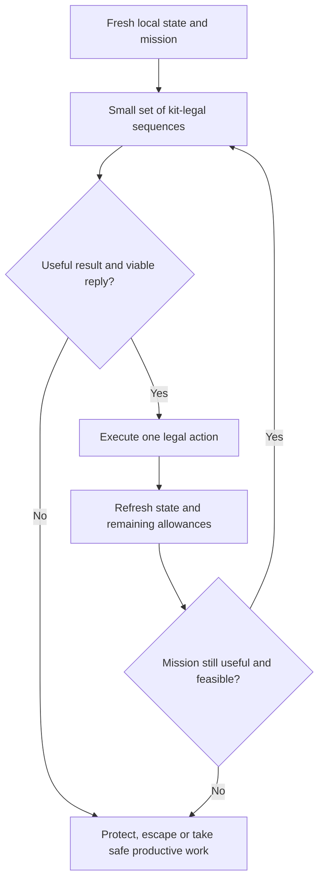

# Combat and survival

**Chapter 07 of 12** · [Tactics index](README.md)

When we fight, how we execute, and when we leave.

**Evidence and status:** Current behavior is the pinned repository source at [`dee0fe7`](https://github.com/Javiops/Cambridge-Battlecode-2026/commit/dee0fe7bf464d9f7b281af81f9650135fc541321), whose six bot source files match `a0c0fa2` byte for byte. A live-v43 source match remains unconfirmed. See the [research, measured opponent behavior and exact episodes](combat-research-2026-10-16.md) for the evidence supporting this revision. The fuller micro rules below are **Planned**; source inspection, legal native sequences and observed opponent actions do not prove that our bot implements them or that they improve results. The same 27 controlled cases and 85 assertions pass on both pinned 0.0.1 and official 0.0.2 engines, with no differences in the retained bounded observations. This is not exhaustive engine equivalence or a strategy-strength test.

## The decision loop

**Choose the mission → compare legal short sequences → price the next reply → execute one action → refresh → continue or leave.**

The opponent study supports persistent recipient pressure, kit-specific sequencing and attention to control/protection effects. It does not justify one universal “always move first”, “always focus the weakest” or “always fight as five” rule. The [research appendix](combat-research-2026-10-16.md) separates measured patterns, exact exchanges and our design choices.

## Contents

1. [Fight selection](#1-fight-selection)
2. [Local strength assessment](#2-local-strength-assessment)
3. [Target selection and focus fire](#3-target-selection-and-focus-fire)
4. [Range control and kiting](#4-range-control-and-kiting)
5. [Ability selection and timing](#5-ability-selection-and-timing)
6. [Action sequencing](#6-action-sequencing)
7. [Escape decisions](#7-escape-decisions)
8. [Chasing and disengagement](#8-chasing-and-disengagement)

## 1. Fight selection

Decide whether engaging is worthwhile given the objective, likely outcome, and cost of interruption.

**Status:** Planned

**Tactic:** When an observed enemy can affect the next useful action, resolve the combat decision before spending health, movement or an essential ability on a discretionary camp hit. Name the result sought: survive, remove an immediate threat, stop a deciding channel, protect a carrier, secure collection, or create a short favourable exchange. A kill without a useful conversion is not automatically the best mission.

Compare a bounded legal sequence with the credible reply and the next productive alternative. Start only when the required participants/actions arrive before the window closes. Keep only actual ready contribution; a body in a radius or a shared camp claim is not an accepted helper. A private remote target is not a legal unit target for us.

**Stop and fallback:** Abort or change the sequence when survival fails, the useful action becomes unavailable, support is late, or the mission disappears. Reposition, protect, recover, or take safe productive work. Do not fall back to the same unsafe camp expenditure merely because the champion fight was declined. Preserve a useful active channel unless an actual permitted cancellation improves the outcome; micro priority does not mean cancel every delivery.

**Current behavior:** A pre-turn spell sweep may act before the emergency decision. Spawn/emergency/near-recall branches precede ordinary kite/front/fallback combat, while ordinary recall, banking and farming follow it. These are distinct heuristics, not one fight-value model. The generic “killable” check is target HP at most twice Strength, which does not establish a legal lethal sequence. [Current branch order](https://github.com/Javiops/Cambridge-Battlecode-2026/blob/dee0fe7bf464d9f7b281af81f9650135fc541321/bots/study27-economy/src/main.cpp#L2910-L3089).

## 2. Local strength assessment

Compare usable damage, health, shields, abilities, positioning, and reinforcement time.

**Status:** Planned

**Tactic:** Begin with our own legal actions and observable participants who can contribute before the next deciding response. Include actual order, movement/attack sharing, the single successful-cast allowance, cooldown progression, stuns/channels, approach tiles and monster attacks. Compare sequences the kit can really perform: do not add an attack-reset double basic to another cast that spends the same allowance, or combine a required walk with an exclusive stationary spell.

Use effective target-aware damage and visible shields/mitigation, plus returned damage and linked-death consequences. In the controlled checks on both engines, Ren returns 0.2 × his effective Focus even when the triggering direct hit is shielded or lethal; killing him can still kill the attacker. The separate Varg splash checks do not trigger that return when Ren is only the secondary recipient. Use verified effect semantics rather than adding return damage for every AoE/splash recipient. A zero-HP-loss hit may consume a shield or apply control, so HP alone is not a complete exchange measure. Recheck the engine pin when the game patch changes.

Requery available stats and restrictions after purchases/actions. A buff showing duration 0 can remain active until the appropriate owner-start phase; use actual state rather than subtracting a world round by intuition. Unknown remote ally health, enemy position or cooldown remains uncertainty. Do not convert it to zero threat or ready power.

**Stop/fallback:** Reassess after new sight, a move/cast, a failed action, a death, an expired window or a missed participant. With incomplete information, retain a legal conservative local sequence rather than pretending to know the team future. The first prototype uses a short local horizon; wider multi-turn margins remain explicit experiment parameters.

**Current behavior:** Front and kite mostly compare nearby HP/counts; fallback uses count and 120% HP. The volley heuristic can combine reset and another spell, omit relevant dash/return effects, and count incompatible action reaches. It is not a guaranteed damage bound. [Threat sum](https://github.com/Javiops/Cambridge-Battlecode-2026/blob/dee0fe7bf464d9f7b281af81f9650135fc541321/bots/study27-economy/src/main.cpp#L751-L881). Use [timely group contribution](06-team-coordination.md#3-group-size).

## 3. Target selection and focus fire

Choose valuable, reachable enemies and coordinate damage when concentrating attacks is beneficial.

**Status:** Planned

**Tactic:** Choose a legal reachable target for the assigned mission. Prefer an action that prevents an immediate loss, secures a valuable lethal sequence, or interrupts a deciding channel. Retain the local focus while its useful action remains feasible; use deterministic ties so bodies sharing the same genuine observations can make compatible decisions. This does not create an omniscient team controller.

Count only follow-up already observable or supplied by an implemented fresh protocol, with timing and legality. Avoid committing extra damage after the target will already be removed within that verified window. Allow a protector to control a diver or a healer to save the required actor instead of forcing every body onto one recipient. Area damage can affect several enemies without those enemies being selected primary targets.

**Stop/fallback:** Requery the selected unit after each action. If it dies, becomes hidden/out of useful reach, or a more urgent threat appears, select another legal useful action or release the fight. Do not spend a reset solely on the dead original target, but consider a different living target when the cast/attack budget really remains. A planned ground cast can use an evidence-based predicted area; it needs a legal centre rather than a visible unit handle. Never use the host's hidden coordinates as bot knowledge.

**Current behavior:** Sweep, kite, front and fallback use different local scores. `P_KITEFRONT=0` lets successful caster kite return before front's focus rule, and no enabled shared focus protocol resolves the difference. The alive-target reset guard preserves the cooldown after a kill but does not deliberately continue onto another target. [Kite focus](https://github.com/Javiops/Cambridge-Battlecode-2026/blob/dee0fe7bf464d9f7b281af81f9650135fc541321/bots/study27-economy/src/fight.h#L498-L519), [reset guard](https://github.com/Javiops/Cambridge-Battlecode-2026/blob/dee0fe7bf464d9f7b281af81f9650135fc541321/bots/study27-economy/src/main.cpp#L1527-L1547). Remote commitments require [06.8](06-team-coordination.md#8-shared-commitments); all eight bytes already have uses.

## 4. Range control and kiting

Maintain useful attack distances while accounting for the tradeoff between movement and attacking.

**Status:** Planned

**Tactic:** Compare a deliberate hold with legal neighbouring positions before moving. Preserve the action that matters: a safe stationary exclusive cast plus basic, a ranged reposition plus a compatible control/support action, a ranged move-reset-shot when that reset is ready and worth its cast, or a melee move/basic sequence. An attack reset restores attack rather than movement in the controlled checks on both engines; do not spend a ranged basic expecting the reset to reopen escape walking.

Choose a position that survives the credible next reply, preserves the mission's useful range, and leaves a usable exit or actual protection. Include current dash/control readiness and order. Do not maximize distance so far that all useful damage is lost, or step closer solely to maintain a target that has ceased to be worthwhile. Ranges use actual kit metadata; a legal area centre can affect a recipient beyond the unit-target cast radius.

**Stop/fallback:** Hold when moving sacrifices the better legal sequence and the reply is survivable. Exit when no useful safe action remains. If a tile is occupied/revealed or an action fails, refresh and use a bounded alternative; do not repeatedly score the same stale tile. Unseen approaches remain uncertainty under [chapter 04](04-vision-and-information.md).

**Current behavior:** Caster kite uses a local threat-count/range/team-distance score, moves before its own spell pass, and yields at distant quiet contact. Front has a different ranged positioning rule. These are implemented baselines, but they do not compare all the legal stationary/reset/escape sequences above. [Kite sequence](https://github.com/Javiops/Cambridge-Battlecode-2026/blob/dee0fe7bf464d9f7b281af81f9650135fc541321/bots/study27-economy/src/fight.h#L458-L589).

## 5. Ability selection and timing

Choose between damage, control, healing, shields, resets, and mobility according to the immediate situation.

**Status:** Planned

**Tactic:** Treat the successful cast as one shared budget across both slots. Compare the immediate mission result of damage, stun, shield, heal, dash and attack reset before using it. Prefer a needed save/escape/interrupt over discretionary damage; prefer a secured useful kill over decorative area coverage. Area damage's extra recipients matter only if their actual damage/control improves the bounded outcome. Do not choose it solely because it hits two units.

For control, check target immunity and existing restrictions, plus whether the new duration changes a future action window. Marcella's stun immunity removes stun value without necessarily removing the damaging component. Refreshing existing control may extend a useful window, but a cast before the victim acts is not automatically wasted or automatically optimal. For support, identify the body and action saved, actual missing HP/expected damage, and competing use of the cast. A shield depletion or heal is useful evidence even without opposing HP loss.

For resets, use current cast/attack state and a living reachable follow-up target. A Vendetta cooldown refresh does not itself refund an already-spent cast in the controlled checks on both engines. Query actual effective stats after gems/purchases and current metadata for scaling; field Health does not imply an immediate heal.

**Stop/fallback:** Recheck after the preceding action and stop when the needed effect is achieved, the cast is spent, or legality/value disappears. If metadata or timing is missing, use the established legal local fallback without claiming a proc, stun or reset that has not occurred. Preserve a needed control/mobility budget from unsafe [camp spending](08-farming-and-capture.md#5-camp-commitment-and-abandonment).

**Current behavior:** Sweep tries threat-control, 2+ area hits, weak-target damage/control and an area-edge fallback. Support tries a low-HP shield or the first sufficiently useful ally heal; general offense scans slots in order. `P_SAVECC=0` does not reserve control for a nearby enemy. [Support/offense](https://github.com/Javiops/Cambridge-Battlecode-2026/blob/dee0fe7bf464d9f7b281af81f9650135fc541321/bots/study27-economy/src/main.cpp#L1504-L1588), [sweep](https://github.com/Javiops/Cambridge-Battlecode-2026/blob/dee0fe7bf464d9f7b281af81f9650135fc541321/bots/study27-economy/src/main.cpp#L3474-L3566).

## 6. Action sequencing

Order movement, attacks, and abilities so one action does not prevent a more important action.

**Status:** Planned

**Tactic:** Decide the legal short sequence before its first irreversible expenditure. Start from fresh position, target, health/max health, buffs/restrictions, cooldowns, action flags and the current owner-turn order. Bound candidate sequences by the kit's actual action budget; do not build a broad unbounded combat optimizer.

| Need | Sequence to consider, when legal | Recheck before follow-up |
| --- | --- | --- |
| Safe stationary damage | Exclusive cast, then basic; or basic/reset/basic | Target survival/shields, counter-damage, cast/attack availability |
| Ranged useful reposition | Move, then compatible cast; or move/reset/basic | Actual landing, new sight, reset value and no restored movement |
| Melee access | Move or dash to a legal action tile, then basic/control if budget permits | Dash and another ability compete for the cast; enemy reply/exit |
| Protection | Required heal/shield/control before the threatened event | Real recipient, effect, timing and remaining movement |
| Escape | Legal lower-threat move/dash/control, then only compatible useful damage | Remaining threats, linked death and returned damage |

Requery after each accepted action and distinguish false/rejected commands from success. A kill can alter cooldowns without reopening cast availability; a new observation can reveal a blocker or invalidate the target. End the sequence at its result or hard safety abort. Continue to a remaining legal useful action after rejection when it does not violate the higher priority.

**Current behavior:** Pre-sweep can precede survival and shopping; `P_CASTSAFE=0` leaves its escape guard disabled. The generic helper resets only after a successful basic, so cannot deliberately unlock the first post-move ranged basic. Support and offense may already spend that cast. `P_U34_ENGAGE_FALLBACK=0` and `P_U34_FAILED_CHANNELS=0` allow attempted but rejected branches to return without a useful fallback. [Outer ordering](https://github.com/Javiops/Cambridge-Battlecode-2026/blob/dee0fe7bf464d9f7b281af81f9650135fc541321/bots/study27-economy/src/main.cpp#L3594-L3697), [engage](https://github.com/Javiops/Cambridge-Battlecode-2026/blob/dee0fe7bf464d9f7b281af81f9650135fc541321/bots/study27-economy/src/main.cpp#L1551-L1566).

**First implementation boundary:** legal short-sequence coverage and fresh-state checks first; survival/counter-damage second; local focus/protection third. Test credible combinations later. A new remote protocol or team-wide optimizer is outside this first change.

## 7. Escape decisions

Decide when to flee, where to go, and whether walking, control, dashing, or recall offers the best survival chance.

**Status:** Planned

**Tactic:** Escape before the next credible sequence kills the body or destroys the mission, including Ren return and Cassi/Issac linked loss. Keep 25% HP, or 35% for the source's Stellar-containing team, only as initial emergency fallbacks; a visible lethal reply can require leaving earlier. A healthy percentage is not proof of safety and must use current post-purchase maximum HP.

Compare legal lower-threat movement, a ready dash, a control/protection cast, and full-channel recall safety. Use a stationary lethal cast only when its returned damage and remaining enemies leave the intended survival outcome viable. Do not spend movement on a basic or an exclusive spell and then discover that the planned escape is unavailable. A protector can open an exit through real control or damage; ordinary occupied-tile rejection does not prove projectile interception.

**Stop/fallback:** Finish escape when a useful safe action/recovery channel is established; re-evaluate if that condition changes. If recall is rejected or interrupted, refresh the cause and use a legal remaining escape/protection action rather than returning after the attempt. If escape is impossible, spend the legal remaining budget to preserve the most useful secured value or protect another required body. Do not chase a doomed extra hit while losing a recoverable carrier.

**Current behavior:** Emergency and generic avoid branches use different gates and movement helpers. HITFIRST avoids a ranged basic while it can still move; safe-step minimizes predicted reach count then healthy-ally/home distance, while emergency flee routes home. Volley pathing is a local heuristic with weaker low-fuel fallback; near-recall uses distance/damage proxies, not a full enemy action schedule. See [recall safety](10-recall-and-recovery.md#2-recall-safety) and [current retreat helpers](https://github.com/Javiops/Cambridge-Battlecode-2026/blob/dee0fe7bf464d9f7b281af81f9650135fc541321/bots/study27-economy/src/fight.h#L111-L179).

## 8. Chasing and disengagement

Decide when pursuing a kill remains worthwhile and when to return to productive objectives.

**Status:** Planned

**Tactic:** Continue pursuit only for a named mission with a feasible next useful action and a survivable response/exit. A channel or valuable bag can justify an intercept, but does not waive readiness, route or opportunity-cost checks. Prefer the earliest legal useful action over following the target's old centre. Keep the target's last observation separate from current personal knowledge.

**Stop:** Disengage when the target dies, its useful action window closes, it leaves credible reach/sight, new support changes the risk, or a safer productive objective becomes better. Release the old commitment and select actual safe farming, capture, banking, protection or recovery. A new high-priority threat can interrupt immediately; minor score changes do not require oscillation between equivalent targets.

**Fallback:** Lost sight does not authorize an omniscient pursuit. Obtain useful personal information under [chapter 04](04-vision-and-information.md) or take a reversible useful route. For the first local prototype, require a credible near-term useful action and re-evaluate after the next action/opportunity; wider pursuit deadlines and uncertainty margins remain explicit planned parameters, not optimized distances.

**Current behavior:** NOCHASE marks observed outward/homeward movement away for 3 rounds and clears within 2. It generally excludes an away target outside basic range unless channeling or holding at least 150 gems; caster quiet-distance gates also release standoffs. These are useful defaults, not a complete pursuit budget or proof that a particular chase was good. [Current observation/exclusion](https://github.com/Javiops/Cambridge-Battlecode-2026/blob/dee0fe7bf464d9f7b281af81f9650135fc541321/bots/study27-economy/src/main.cpp#L2821-L2887).

---

[← Team coordination and group movement](06-team-coordination.md) · [Tactics index](README.md) · [Farming and camp capture →](08-farming-and-capture.md)
