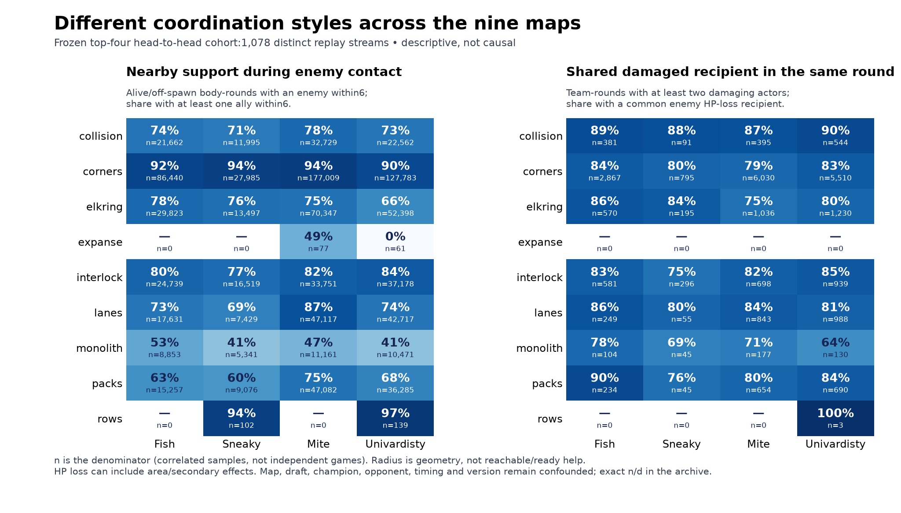
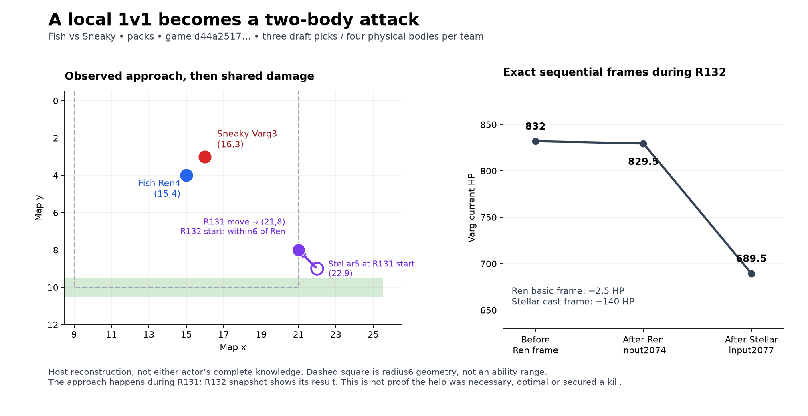

# Team coordination research — 16 October 2026

[Operational tactics: Chapter 06](06-team-coordination.md)

Our proposed starting point is **temporary cooperation around a specific job, with timely useful actions and an explicit end**. A team can look coordinated because its members approach compatible positions, damage a shared reachable enemy, leave one body to collect a reward, and convert a short advantage into a bank. It does not need to move as one permanent blob.

The question “why do they look decisive?” has two answers with different evidence. We can measure repeated recipient choices and shared action sequences. We cannot see their private planner, role assignments, memory protocol or rejected alternatives. Similar local rules and observations could also produce coherent-looking behavior without a centralized shotcaller. Our proposed commitment/abort protocol is an original hypothesis, not a reverse-engineered opponent algorithm.

The top four in the unchanged ward/shopping snapshot are **Intercontinental Fish, Sneaky Bush Campers, Mite and Univardisty of Shingtonwash**. All ten frozen teams are retained. This is research and documentation only: no bot code was changed or new competitive bot simulations run. The eight practical topics remain **Planned**.

## How to read the evidence

- **Confirmed mechanics** come from official rules, SDK/source checks and seven new native cases with 22 passing assertions.
- **Observed behavior** is source-bound native position/action/HP/resource evidence, reconstructed sequentially from the frozen replay cohort.
- **Interpretation** explains a plausible mechanism while preserving alternatives. A spatial group is not automatically ready help, and an HP-loss recipient is not necessarily the actor's chosen primary target.
- **Planned strategy** turns those observations and LoL lessons into conditions our bot can implement and test. It is not a demonstrated win-rate improvement.

## Main practical findings

**Their cooperation is selective.** In top-four head-to-head games, nearby ally support occurs in about69–78% of off-spawn living body-rounds, rising to77–85% during geometric enemy contact. Yet disjoint work on multiple camp groups also occurs in about19–25% of camp-work team-rounds. A useful team alternates concentration with productive division of work.

**They often keep damaging the same reachable opponent.** When at least two teammates have direct attack/cast frames with enemy HP loss in one world round, about79–84% of those rounds include a shared enemy recipient. In consecutive own PvP-damaging rounds, recipient sets overlap about91–93% of the time. These are conditional descriptions; a lone available enemy, area damage or continued necessity can explain persistence without a private target lease.

**Clearing, collecting and banking are different jobs.** About96–99% of confirmed top-four head-to-head camp rewards have one recipient. Multiple bodies may help before that boundary, but extra holders do not accelerate capture. Exact episode evidence below includes productive split farming and a champion finishing a48-point bank amid nearby fighting before resuming combat.

**More grouping is not automatically better.** Mite groups more frequently by several spatial measures; Fish is not always the most grouped team, and rank8 Nyxius has the highest all-cohort conditional shared-recipient percentage in the ten-team table. Ranks, compositions, opponents and chronology confound these comparisons. Neither a larger group nor a higher focus percentage is an objective by itself.

The figure shows different denominators in its two panels. Zero-denominator cells are missing observations, not0% coordination; the rows100% value has only three qualifying multi-attacker team-rounds. Exact table and figure numerators/denominators are included in the evidence archive.

The replay evidence supports a mixture of nearby formations, shared combat and split economic work. Across the top-four head-to-head games, an on-field body has another ally within six tiles in 68.71–77.72% of sampled body-rounds; when geometric enemy contact exists, the corresponding grouped-contact share is 76.67–84.58%. These are spatial facts, not proof that another body could act, saw the same information, or received a shared assignment. Actual native attack/cast frames separately show shared enemy HP-loss recipients. Camp rewards usually go to one body, even when the team performs camp work in several locations during the same world round.

## Cohort, source and denominators

The cohort is exactly the prior ward/shopping freeze: 3,766 API match IDs, 2,119 distinct raw SHA-256 streams, 4,238 team/game observations and 21,312 champion-body/game appearances. The additional 1,647 IDs alias raw streams already counted. Top-four head-to-head includes 2,460 IDs / 1,078 raw streams. Fixed ladder ranks come from 2026-10-15 22:51:52 UTC; selected matches span October 13–15. No outcome filter was used, and raw-distinct games are not asserted to be independent bot versions or experiments. Private submission/version identifiers are unavailable.

All 2,119 official native trajectories were decoded sequentially with WASM SHA `ce302dc6666ae43592f6936e572bc4baca92a345bff13ef7f986609ac666a0dc`. The extraction contains 1,047,385 fixed-stage world-round snapshots, 10,442,536 separately identified owner-turn starts, 8,942,482 retained actor commands and 3,779,432 HP-loss frames, including neutral/environment frames. The canonical round snapshot is the first phase10 frame with the complete roster, after that round’s environmental phases. It is one sequential world state; actions within a world round are never assumed simultaneous.

“On field” means alive and outside that body’s own embedded spawn rectangle. Proximity excludes dead and own-spawn bodies on both sides. The principal denominator is on-field champion-body × sampled world round. Channeling bodies remain included and have separate exposure counters; proximity does not establish readiness. Radius6 is Chebyshev distance, includes the focal body in allied counts, and is supplemented by radii3/8 and a distinct-pick measure collapsing Cassi/Issac. Connected components can form chains; they are secondary descriptors, not a cohesion or reachability test. Omniscient coordinates are not proof of the information available to either bot; remote allied GPS/team sight are not assumed.

## All ten teams

| Team | Streams / body appearances | On-field body-rounds | Another ally≤6 | Enemy-contact body-rounds | Grouped contact≤6 | Shared recipient / multi-attacker PvP rounds |
| --- | --- | --- | --- | --- | --- | --- |
| Fish | 567 / 2,938 | 1,276,308 | 75.66% | 267,093 | 80.95% | 5,770/6,863 (84.07%) |
| Sneaky | 380 / 1,876 | 739,541 | 68.87% | 164,095 | 77.44% | 2,544/3,129 (81.30%) |
| Mite | 1011 / 5,295 | 2,231,062 | 77.64% | 494,904 | 84.47% | 9,173/11,500 (79.77%) |
| Univardisty | 821 / 4,037 | 1,751,563 | 70.96% | 411,312 | 78.17% | 9,778/11,926 (81.99%) |
| VeryGood | 227 / 1,176 | 497,965 | 77.82% | 114,917 | 82.32% | 1,763/2,125 (82.96%) |
| Quantom | 264 / 1,233 | 496,700 | 59.59% | 102,846 | 65.63% | 1,608/2,181 (73.73%) |
| hello | 264 / 1,321 | 585,758 | 71.51% | 143,585 | 81.18% | 4,062/4,923 (82.51%) |
| Nyxius | 243 / 1,196 | 468,629 | 65.53% | 111,948 | 72.67% | 1,400/1,551 (90.26%) |
| geese geese go | 221 / 1,087 | 441,993 | 68.05% | 89,614 | 77.96% | 2,025/2,494 (81.19%) |
| Full Damage | 240 / 1,153 | 481,116 | 68.03% | 101,209 | 74.04% | 964/1,297 (74.33%) |

The last column conditions on world rounds with at least two distinct actors whose native direct attack/cast frames contain enemy HP loss. A shared recipient means the same stable enemy body ID loses HP during frames associated with at least two of those actors in that round. This avoids nearest-target guessing. It does not identify a chosen primary target, a common private objective, or causal damage from every secondary effect. The primary measure excludes delayed spell/environment frames; those frames remain in the trace. An AoE frame may have several recipients.

## Top-four head-to-head: local numbers, persistence and shared attacks

| Team | Contact grouped / contact body-rounds | Local ally count > enemy count | Local ally count < enemy count | Shared recipient / all PvP team-rounds | Shared recipient / multi-attacker rounds |
| --- | --- | --- | --- | --- | --- |
| Fish | 165,712/204,405 (81.07%) | 127,888/204,405 (62.57%) | 27,380/204,405 (13.39%) | 4,208/24,093 (17.47%) | 4,208/4,986 (84.40%) |
| Sneaky | 70,496/91,944 (76.67%) | 53,476/91,944 (58.16%) | 11,800/91,944 (12.83%) | 1,208/9,949 (12.14%) | 1,208/1,522 (79.37%) |
| Mite | 354,612/419,273 (84.58%) | 275,789/419,273 (65.78%) | 50,402/419,273 (12.02%) | 7,804/54,805 (14.24%) | 7,804/9,833 (79.37%) |
| Univardisty | 257,752/329,594 (78.20%) | 186,444/329,594 (56.57%) | 51,329/329,594 (15.57%) | 8,315/48,101 (17.29%) | 8,315/10,034 (82.87%) |

Local numbers are centered on each focal body. Radius overlap, terrain, range, cooldowns, health, items, turn order and personal vision can make a numerical edge unusable. The same engagement may contribute several body-rounds and both sides. These percentages are exposure-weighted descriptions, not independent engagements or causal win estimates.

| Team | Local ally count1 /2 /≥3 (field body-rounds) | Other draft pick≤6 | Recipient overlap in consecutive own PvP rounds | Similar pair heading / nearby pair transitions with both moving |
| --- | --- | --- | --- | --- |
| Fish | 238,378 / 258,803 / 489,604 | 72.48% | 10,822/11,934 (90.68%) | 149,356/342,739 (43.58%) |
| Sneaky | 127,658 / 112,780 / 167,507 | 65.98% | 3,523/3,809 (92.49%) | 51,367/108,965 (47.14%) |
| Mite | 414,337 / 458,091 / 986,952 | 74.00% | 26,331/28,245 (93.22%) | 264,186/596,460 (44.29%) |
| Univardisty | 406,952 / 405,039 / 588,243 | 68.36% | 23,457/25,101 (93.45%) | 149,939/382,735 (39.18%) |

Recipient overlap counts consecutive world-round pairs in which the same actor has enemy HP-loss recipients in both; the recipient sets intersect. It is a narrow observed persistence proxy, not proof of a target lease, deliberate commitment or good target selection. Similar heading requires both members of a previously nearby pair to move between consecutive fixed snapshots, cosine≥0.8 and continued separation≤6; it does not establish a shared route plan. Raw zigzags/reversals are not labeled indecision because obstacles, threat, ability timing and deadlines are not counterfactually observed.

The broad reinforcement counter is kept as a diagnostic only: a 1:1 geometric contact anchor is followed within three snapshots by the same focal and enemy with at least two allies versus one enemy. Intermediate contact may lapse. Its HP-loss co-occurrence window runs from anchor through reinforcement+1 and does not require post-arrival or same-round action; anchors overlap. The two curated reinforcement episodes below satisfy stricter continuous-contact, actual approach and post-join same-round evidence.

## Economic splitting, rewards and banking

| Team | Disjoint multi-camp work / any camp-work rounds | Single recipient / confirmed camp rewards | Reward has recipient absent from observed direct damagers | Submission with nearby ally / all submissions | Submission with nearby enemy / all submissions |
| --- | --- | --- | --- | --- | --- |
| Fish | 21,333/113,504 (18.79%) | 11,614/11,738 (98.94%) | 712/11,738 (6.07%) | 4,344/7,824 (55.52%) | 1,115/7,824 (14.25%) |
| Sneaky | 13,573/54,130 (25.07%) | 4,322/4,483 (96.41%) | 397/4,483 (8.86%) | 2,044/3,480 (58.74%) | 571/3,480 (16.41%) |
| Mite | 47,299/226,433 (20.89%) | 20,993/21,383 (98.18%) | 1,901/21,383 (8.89%) | 11,174/18,461 (60.53%) | 3,031/18,461 (16.42%) |
| Univardisty | 34,133/162,230 (21.04%) | 15,474/16,049 (96.42%) | 1,092/16,049 (6.80%) | 6,843/11,648 (58.75%) | 1,551/11,648 (13.32%) |

Multi-camp work means distinct camp-group IDs suffer HP loss during direct same-team attack/cast frames in one world round, with each actor observed on only one of those groups that round. The commands remain sequential. “Single recipient” comes from exact positive gold/gem changes at native capture resolution, not inferred proximity. A recipient outside the observed direct damager set may reflect role splitting, delayed effects or other unmeasured contribution; it is not automatic proof of a planned handoff. A submission is a positive score change with a unique personal gem decrement. Nearby bodies are geometric context, not verified escorts or attackers.

## Nine maps, fixed roster sizes and champion conditioning

The following top-four head-to-head table shows field-support percentages per team, followed by total recorded direct PvP team-rounds for those four appearances. Full per-map numerators/denominators are in `map-team-summary.csv`; one game contributes to each participating team, so the final column is a count of team-rounds, not unique engagements.

| Map | Fish ally≤6 | Sneaky ally≤6 | Mite ally≤6 | Univardisty ally≤6 | Top4 PvP team-rounds |
| --- | --- | --- | --- | --- | --- |
| collision | 75.73% | 64.42% | 79.00% | 66.62% | 12,216 |
| corners | 81.42% | 84.97% | 86.62% | 78.55% | 56,339 |
| elkring | 85.25% | 80.85% | 80.89% | 73.47% | 20,376 |
| expanse | 49.86% | 25.86% | 64.84% | 36.36% | 16 |
| interlock | 78.90% | 69.98% | 76.78% | 77.59% | 15,448 |
| lanes | 73.35% | 69.38% | 75.12% | 73.65% | 13,570 |
| monolith | 67.20% | 55.98% | 61.09% | 59.90% | 5,149 |
| packs | 68.88% | 61.46% | 71.62% | 62.61% | 13,817 |
| rows | 80.70% | 80.43% | 80.16% | 79.29% | 17 |

Rows is a useful counterexample to “grouped means attacking”: field support is about79–81%, while the top-four appearances contain only17 direct PvP team-rounds there. Expanse has only16 such team-rounds across the top-four head-to-head cohort; Fish and Sneaky have none. Corners has much more enemy-contact/combat exposure. These observed map patterns do not establish geometric causes or adaptive code: map, draft, chronology, opponent, private versions and game duration remain entangled.

Draft slots and physical bodies differ when Cassi/Issac occupies one pick but two bodies. The h2h strata are explicitly exported in `roster-size-summary.csv`; Fish and Mite use3/4,4/5 and5/6 slot/body combinations, while Sneaky and Univardisty also have some rosters without the pair. The primary radius6 support pattern remains when the pair is collapsed to one draft pick; body support and other-pick support are both shown above. No team-wide ranking is interpreted as a causal effect of grouping.

| Team / champion | Body appearances | Field body-rounds | Another ally≤6 | Own PvP-damaging actor-rounds | Own camp-damaging actor-rounds | Actual submission events |
| --- | --- | --- | --- | --- | --- | --- |
| Fish / Issac | 437 | 184,143 | 72.62% | 3,485 | 39,098 | 1,810 |
| Fish / Stellar | 376 | 170,983 | 78.83% | 6,575 | 38,717 | 1,217 |
| Sneaky / Issac | 189 | 62,651 | 66.99% | 791 | 15,250 | 669 |
| Sneaky / Stellar | 220 | 83,757 | 70.46% | 3,104 | 19,800 | 647 |
| Mite / Issac | 839 | 345,388 | 80.77% | 7,605 | 89,328 | 3,873 |
| Mite / Stellar | 594 | 247,111 | 80.18% | 12,453 | 46,564 | 2,367 |
| Univardisty / Issac | 454 | 183,213 | 70.44% | 3,246 | 41,439 | 1,610 |
| Univardisty / Stellar | 557 | 243,307 | 73.24% | 12,263 | 47,049 | 2,036 |

These action counts describe what each champion did. They do not assign hidden fighter/farmer/escort roles from position alone. Some bodies perform more than one task within a round. All team×champion×map tables are exported, with explicit sample counts; even those comparisons retain chronology/opponent/build confounding. Spawn, dead, channel and owner-turn counters remain available in the body/game ledgers, rather than being treated as ordinary combat availability.

## Recent and early-game sensitivity

The latest slice selects the newest two API IDs per unordered pair×map×game kind by timestamp then ID, before raw deduplication:1,513 IDs / 1,174 raw streams. Its top-four head-to-head intersection is 133 raw streams, with Fish 62/Sneaky 64/Mite 84/Univardisty 56 team appearances. “Latest” is a relative stratified slice, not a single known private code version.

| Team | All h2h field support≤6 | Latest h2h field support≤6 | All h2h grouped contact | Latest h2h grouped contact | Early R25–150 field support: all h2h → latest h2h |
| --- | --- | --- | --- | --- | --- |
| Fish | 75.84% | 74.55% | 81.07% | 80.38% | 79.60% → 77.29% |
| Sneaky | 68.71% | 68.37% | 76.67% | 77.28% | 68.74% → 67.99% |
| Mite | 77.72% | 77.16% | 84.58% | 84.51% | 78.33% → 77.60% |
| Univardisty | 70.94% | 72.17% | 78.20% | 80.41% | 75.52% → 76.63% |

Every one of the 2,119 streams has all 126 fixed-stage snapshots R25–150; available/full-window subsets therefore coincide. The early comparison reduces differences arising solely from late-game duration. The main proximity patterns persist, but exact rates and combat exposures move; no invariance or current-policy identity is claimed. Complete early counts and direct-focus denominators are in `early-window-summary.json` and its team/body CSVs. Radius3/8 results are retained in the main summary; the six-tile threshold is a descriptive scale, not a universal assistance range.

## Thirteen episodes, including an adverse continuation

All cases in `cases/index.json` bind raw, compressed bundle and native trace hashes, source URL and same-raw aliases. They include terrain buffers plus printable map rows, champion types, exact HP/positions, sequential input/seq actions, actual displacement routes, captures/submissions/deaths and context snapshots. Selection illustrates mechanisms and counterexamples; it is not a representative success-rate sample.

| Case | Match / map / round | Observed mechanism |
| --- | --- | --- |
| 01 one_to_two_vs_one | [d44a2517…](https://2026a.battlecode.co.uk/game/match-groups/3881dcf3-eb9f-44a2-b82e-5e4fda9e9cb0) / packs / R131 | continuous contact; actual helper approach; post-join same-round recipient HP loss |
| 02 one_to_two_vs_one | [781a2be6…](https://2026a.battlecode.co.uk/game/match-groups/b006842b-f7d4-47c6-9c53-9aebcf05804c) / interlock / R578 | continuous contact; actual helper approach; post-join same-round recipient HP loss |
| 03 larger_joint_attack | [9c830c09…](https://2026a.battlecode.co.uk/game/match-groups/958f2867-cc7c-4dab-abe8-16c2d220ee26) / corners / R40 | larger joint attack |
| 04 larger_joint_attack | [aa1d9761…](https://2026a.battlecode.co.uk/game/match-groups/fc87f70f-9dd1-4f1a-b246-427119471f4b) / corners / R92 | larger joint attack |
| 05 split_camp_work | [d0ec9528…](https://2026a.battlecode.co.uk/game/match-groups/c99b0fe9-b7d2-4543-8ec5-6af852857843) / corners / R22 | split camp work |
| 06 capture_handoff | [d869ea34…](https://2026a.battlecode.co.uk/game/match-groups/b006842b-f7d4-47c6-9c53-9aebcf05804c) / collision / R70 | recipient absent from observed direct damagers; planned handoff unproved |
| 07 contested_group_submission | [fb3e09a7…](https://2026a.battlecode.co.uk/game/match-groups/22f310e3-fb4c-4a3e-b4d8-325cf3f4a17a) / corners / R43 | contested group submission |
| 08 geometric_disengagement | [3660dd73…](https://2026a.battlecode.co.uk/game/match-groups/958f2867-cc7c-4dab-abe8-16c2d220ee26) / packs / R219 | separation from prior enemy positions; actual contact persists |
| 09 shared_attack_adverse_continuation | [8bc79c59…](https://2026a.battlecode.co.uk/game/match-groups/396cbc87-ee90-475a-8e1f-0f570267899e) / interlock / R273 | recipient survives two snapshots; an attacker dies in the continuation |
| 10 larger_joint_attack | [f9f576b4…](https://2026a.battlecode.co.uk/game/match-groups/9be12f18-d1f9-4073-8411-056515e1f350) / corners / R26 | larger joint attack |
| 11 larger_joint_attack | [c58b2e34…](https://2026a.battlecode.co.uk/game/match-groups/42a30af8-86db-4a87-ba9d-7b3ac67bb007) / corners / R32 | larger joint attack |
| 12 split_camp_work | [9f57b5a5…](https://2026a.battlecode.co.uk/game/match-groups/8a4f5210-27e0-4675-b93d-eee6aa826fed) / lanes / R34 | split camp work |
| 13 collective_geometric_withdrawal | [8dfb72d3…](https://2026a.battlecode.co.uk/game/match-groups/a87276b6-9e3a-4efc-b0b6-7be996d26a4d) / corners / R380 | two allies separate from actual enemies and stay connected; intent unproved |

Case 01, Fish versus Sneaky on packs, is a concrete stronger sequence. At the first R131 snapshot, Fish Ren 4 at (15,4) is in radius6 contact with Sneaky Varg 3 at (16,3); Fish Stellar 5 at (22,9) is outside Ren’s support radius. During R131, Stellar’s actual move is input 2064/seq 13464, (22,9)→(21,8). The first R132 snapshot now has both Fish bodies within radius6 of Ren while the same enemy remains. During R132, input 2074/seq 13537 Ren’s basic-attack frame records Varg HP 832→829.5, then input 2077/seq 13555 Stellar’s cast frame records 829.5→689.5. These are distinct draft picks with a real approach and shared recipient after joining; private coordination intent and immediate prior visibility are not established. R132 snapshot HP precedes those R132 actions; R133 reflects the resulting 689.5 HP.

Case 09 prevents an overly positive reading. In Fish versus Sneaky on interlock, three Fish actors share an enemy HP-loss recipient during R273. That enemy is still alive with 102 HP at the first R275 snapshot; Fish attacker 7 then dies during R275 with 22 gems. Joint damage did not guarantee a kill or safety over that interval. This does not prove the group decision was wrong or caused the death. Case 06 separately preserves all observed camp HP-loss frames since the prior reward to examine the timing behind a handoff-like recipient change.

Case 07 shows different actual tasks within a nearby formation. In Fish versus Sneaky on corners, Fish Stellar 7 remains at (34,33), channeling with 48 gems at the R42/R43 snapshots while Ren 6, Cassi 8 and Issac 9 have attack frames reducing Sneaky Willow 4 HP 185→75 during R42. During R43, Ren’s input 1080 reduces 75→35; Stellar’s native channel completion at input 1083/seq 6971 submits 48 score, then its input 1084 basic-attack frame records Willow 35→0. Ryth 10’s input 1094 cast has a different recipient, Sneaky Stellar 2, HP 750→650. These are observed banking, attacks and a second combat recipient in sequential frames; a common private role assignment is not established.

Case 08 is only separation from prior enemy positions, not verified contact breaking: the enemy can follow, and actual radius6 contact persists in that episode. The stronger Case 13 adds actual-current-enemy separation. Univardisty versus Sneaky on corners, [8dfb72d3…](https://2026a.battlecode.co.uk/game/match-groups/a87276b6-9e3a-4efc-b0b6-7be996d26a4d): during R380, Stellar 6 moves (35,37)→(36,36), input 10251/seq 63799, and Tavi 9 moves (36,37)→(35,36), input 10265/seq 63857. For both, nearest actual enemy distance increases 5→7 at the R381 snapshot; their own displacement also increases distance from prior enemy positions 5→6. They remain alive and within radius6 of one another through R382, at (37,35)/(34,35). Stellar is 205/750 HP at departure and receives 48 gems by R381, so the continuation also contains an economic reward; it cannot be attributed solely to a deliberate retreat. This case came from a bounded search of existing candidate traces, not a full-cohort retreat-frequency estimate.

## Audit and limitations

`current-audit.json` passes with zero errors across 2,119 source-bound traces and 21,312 final body appearances. All raw hashes, complete sampled rosters, unique/sorted round samples and final native–API roster/type/team/gold/gems/earned gold/KDA/score/round checks pass. Six native workers finished in 388.94 seconds; cached aggregation used six workers and bounded per-game parsing. No bot simulation, bot modification or new cohort acquisition occurred.

The evidence measures observed formations, motion, damage-recipient associations and resource resolution. It cannot recover a private grouping/role algorithm, a target lease, intention, unobserved rejected commands, opportunity cost, or a causal effect on winning. Geometry is not line of sight, walkable reach or readiness. Actual movement paths establish only observed traversal; no hypothetical shortest-path model is substituted. Sparse fixed-stage world snapshots can miss intra-round regrouping; native action/HP frames remain exact and sequential. Overlapping body-rounds, repeated maps/opponents, chronology and unavailable private versions prevent treating rows as independent trials.

Core summary SHA256: `a396b2b4107d43a23bd683d6acfb569aedec21ead6f0e246f9604ca53b5e8856`. Early summary SHA256: `a905b830619228f726929d6d85a036d0e7bfc7e3c971fcf372f6e52cae9e48c5`. Full tables: `team-summary.csv`, `map-team-summary.csv`, `roster-size-summary.csv`, `conditional-role-summary.csv`, `team-game-metrics.csv`, `body-game-metrics.csv`, `camp-rewards.csv`, `submissions.csv`, `shared-recipient-rounds.csv`, `early-window-summary.json`, early team/body CSVs, and `cases/index.json`.

## What the concrete episodes teach

### A real local overload, without assuming it was necessary

The packs example demonstrates the difference between “a second body is going there” and “a second body can contribute now.” Stellar approaches during R131, is present in the R132 fixed snapshot, and has a real damaging cast frame during R132 after Ren's frame. The cast's area can hit a recipient other than its center. This proves a timely two-actor recipient sequence, not an optimal gank, a saved Ren, a necessary intervention or a secured kill. The bodies' personal knowledge and private communication are not reconstructed.

### Larger groups and actual split work

The larger-attack cases cover all four leaders. In case03, five Fish actors—Ren6, Stellar7, Cassi8, Issac9 and Ryth10—have native frames with HP loss at Sneaky Issac1 in R40 on corners. Case04 has Sneaky Stellar2, Prism3 and Willow4 sharing Fish Varg11 as a damaged recipient in R92. Case10 has Mite Varg0, Stellar1 and Ryth4 sharing Fish Ren6 in R26. Case11 has Univardisty Cassi0, Issac1, Marcella2, Tavi4 and Varg5 sharing Mite Varg6 in R32. These are physical actor counts; Cassi/Issac is one draft pick. Area/secondary effects and other recipients mean this is not proof every actor selected one common primary target.

Contrast case12: during R34 on lanes, all six Univardisty bodies have observed camp HP-loss frames on six distinct groups—Ren0→8, Ryth1→10, Cassi2→12, Issac3→36, Varg4→38, Tavi5→40. Case05 gives another multi-location farming example for Sneaky. A team can divide work deliberately or through compatible local priorities; the output proves the work, not the hidden assignment process. A future group should release members when their additional presence has little value.

### A bank is a team objective even while combat continues

In case07, Fish Stellar7 completes a48-point submission during R43, input1083/seq6971, on corners. Exact personal gems fall48→0 and score rises48. Five other Fish bodies and two enemies are within six tiles at that resolution; this is geometric context, not proof of a planned escort.

The sequential actions show useful division of work: Fish Ren6 attacks Sneaky Willow4 at input1080, reducing HP75→35. Stellar finishes the bank at1083, then its own basic-attack frame at1084 reduces Willow35→0. During R42, an enemy Stellar cast had reduced the banking Stellar550→410. Thus “everyone must attack now” would not describe the observed sequence. Do not infer that allies guaranteed the bank, or that proximity itself supplied protection.

### Role separation and the limits of a handoff proxy

Case06's historical machine label is `capture_handoff`, but the evidence is narrower. Fish Stellar4 and Cassi5 have observed direct HP-loss frames at gold-cluster camp9; the last such Cassi frame is R56. Issac6 reaches its region in R64, capture starts R65, and Issac receives35 gold/0 gems in R70 before leaving. The delay does not establish an immediate holder-to-holder handoff or an explicit capture contract. The full earlier camp HP history is preserved, and absence from direct damagers does not exclude delayed/other contributions. Our planned safe handoff requires stronger actual region/phase overlap.

### Continuing together is not the same as continuing correctly

Case09's enemy Ren2 remains alive at102HP at the first R275 snapshot after shared Fish recipient frames in R273. Fish Issac7 then dies during R275 with 22 gems, and linked Cassi6 dies at the same input4797. Ren2 subsequently dies in R276. This is not “the group never got the kill”; it demonstrates that joint damage did not ensure an immediate kill or preserve the actors through the intermediate boundary. No causal claim is made that grouping caused their losses.

Case08 is also deliberately limited: Issac moves farther from the *prior* enemy positions, but the enemy Ren follows; Issac is still within four tiles of the current Ren in the R220 snapshot. This is not proof of a safe exit, contact break or coordinated retreat. Our collective-retreat design is a proposal, not an inferred universal doctrine of the top teams.

Case13 provides a stronger observed collective separation. During R380 on corners, Univardisty Stellar6 moves(35,37)→(36,36), while Tavi9 moves(36,37)→(35,36). At the first R381 snapshot, each body's distance to the nearest actual enemy increases5→7; their own moves also increase distance from the previous enemy positions5→6. Both remain alive and within six tiles of each other through R382. Stellar has205/750HP and receives48 gems at R381, so the movement can have an economic purpose as well as threat separation. It does not prove an explicit retreat command, shared knowledge, optimal safety or a causal benefit. This case was found by a bounded look at one existing candidate trace, not a cohort-wide retreat-frequency search.

## Why they can look more decisive

The evidence supports three visible ingredients: persistent useful engagement, actual overlapping action contributions, and conversion into captures or submitted score. The recipient-persistence and exact post-arrival cases substantiate those appearances. They do not reveal whether the implementation uses a leader, identical local scores, long-lived targets, shared memory or hardcoded routines. We also have not measured rejected plans or established that every pause/reversal is indecision.

For our design, **decisiveness means executing one still-valid intent long enough for follow-up**, with a clear abort when its premise breaks. It does not mean never retreating or never reconsidering. An entry/stay margin can suppress small score noise; a dead required ally, missed deadline, illegal target, imminent lethal risk or meaningful enemy reinforcement must override persistence. Lease lengths and advantage margins remain experiment parameters. No fixed number is claimed optimal from these replays.

## LoL lessons that transfer, and those that do not

The research uses primary interviews, original team-published guidance and official analyst commentary. Professional-organization publication does not make every paragraph direct pro testimony. Historical sources provide mechanisms, not current-patch build advice; embedded videos were not watched or used as evidence.

| Source principle | Battlecode adaptation to test | Necessary limit |
| --- | --- | --- |
| Biofrost evaluates current power, cooldowns and nearby numbers in his [support interview](https://dignitas.gg/articles/a-comprehensive-support-guide-with-dignitas-biofrost),18Nov2022 | A local overload counts first useful legal actions before the enemy response, not nearby names | Two allies separated by a wall or an action delay can still fight as two solo entries |
| The same interview separates engaging from protecting allied output; Dignitas's [original teamfight guide](https://dignitas.gg/articles/5-tips-to-improve-your-teamfighting-ft-team-dignitas),1Nov2017, discusses role-dependent positioning and cooldown answers | Assign initiation, follow-up, interrupt and protection according to the actual mission and kit | A melee champion need not dive; a low-damage actor may best enable another actor's action. An occupied tile can block walking, not all incoming projectiles |
| Biofrost's [warding interview](https://dignitas.gg/articles/pro-level-warding-guide-with-dignitas-biofrost),15May2022, discusses objective approaches; author guidance warns against unsafe/late setup | Prepare an approach, useful personal information and fallback before exposing a valuable carrier or starting a contest | Allied ward sight is not shared. Do not die assembling perfect vision or continue after the useful window passes |
| Dignitas's historical [composition guide](https://dignitas.gg/articles/how-should-your-team-composition-close-out-a-game),20Mar2014, relates grouping and concurrent split pressure to composition | A split body gets a concrete capture, bank, denial or interception job while the group exploits a real diversion | No minion wave/tower pressure,1–3–1 prescription, XP-level spike or Smite timing transfers |
| Its [macro guide](https://dignitas.gg/articles/macro-game-level-up-a-mid-to-late-game-league-of-legends-guide),26Mar2020, links reset, buying and objective arrival | Work backward from the latest useful arrival; synchronize readiness or use a verified staggered role handoff | Recall+return travel and lost capture phases matter. Do not reset every body simply because one needs shopping |
| [Jatt's official LCS analysis](https://lolesports.com/en-US/news/10-thoughts-going-into-lcs-spring-week-7),8Mar2023, critiques fight lines that prevent allied damage and unclear strategic direction | Choose positions that enable follow-up, and keep one coherent mission while its assumptions hold | This is original analyst interpretation, not a causal experiment or universal formation |
| [Yeon's firsthand interview](https://teamliquid.com/news/2023/01/25/yeon-no-pressure-for-the-rookie),25Jan2023, describes CoreJJ communicating intended play more freely | Communicate the minimum actionable intent and its validity rather than only a destination | Rich voice comms do not fit eight team bytes; no claim that one leader/language/protocol guarantees wins |

Our original policy is **separate useful tasks → rally if needed → establish ready positions → commit → convert or exit → recover/reassign**. A protection response and hard abort remain available throughout. This is a conceptual state machine, not an implemented global controller.

For a proposed extra participant, rank the additional secured objective or prevented loss against travel/absence, its best forgone task, congestion and risk. Count the expected reward once while retaining who personally receives it. First compare only a solo, pair and available larger group. A pair can exploit an isolated enemy if both contribute before escape/reinforcement and the first survives; four bodies can secure an important contested objective when all four add relevant timely capability. Four is not a default goal.

Give the group an explicit conversion task after pressure: finish the capture, let the chosen carrier bank, deny an imminent tribute, take another feasible reward or exit. Bound pursuit by the conversion/escape window. LoL's useful lesson is coordinated timing and division of work; Battlecode must supply its own path, phase, personal-information and reward model.

## Our existing bot

The source audit pins the cleaned study27 combat derivative at [e72cec84391cf0623d15c2eb3f2f864e2b0bddea](https://github.com/Javiops/Cambridge-Battlecode-2026/commit/e72cec84391cf0623d15c2eb3f2f864e2b0bddea), matching six source hashes recorded in the evidence. This is the same reference used by the shopping study, not a claim about the current active upload or latest main code.

| Source fact | Consequence to investigate |
| --- | --- |
| Camp claims encode intention without age, ETA, accepted role or readiness; channel/recall/tribute paths do not always clear them | “Coming” can include an unavailable body. Replacing intent counts with ready contribution could change exposed openings |
| Initial camp assembly counts living visible allies within7 and all matching claims; the squad estimate assumes identical owner DPS/equal tanking | Radius/claim counts can overstate the first volley or hide serial arrivals; actual kits, paths, cooldowns and HP matter |
| Current capture helper can nominate a still-claimed ally within4 rather than requiring actual region presence | A promised handoff can precede arrival; verify continuous occupancy and phase overlap |
| Pre-sweep, ranged kite and melee front-line select locally, with different rankings; early casts may already be spent | A later common focus cannot recover an earlier committed cast. Align the earliest relevant action, preserving interrupts/peel/AoE exceptions |
| Explicit group/ball/help/twin/fight-state routines are disabled in this configuration; no `set_priority` occurs | Dormant code comments are not implemented team movement. Similar-looking local behavior is not a shared contract |
| Five ordinary claim slots; six packed claims only when group count≤63 | The sixth body cannot publish a normal claim on larger unseen group sets; any replacement protocol needs a tested identity/capacity design |

Detailed source line ranges, active flags and six hashes are retained in `our-policy-review.md` and `our-policy-notes.json` inside the archive. These are specific source-derived failure mechanisms, not proof they caused any top-team replay outcome. The current source already has useful target persistence; new group coordination should not discard it blindly.

## Mechanics that bound an implementable plan

Seven new cases contain 22 passing assertions. Host team writes are visible to later allied input boundaries in the same world round and persist across later rounds. Team buffers are separate, range overruns are rejected, and draft memory is readable but not writable during play. The test does not establish multi-call atomicity across guest fuel suspension or arbitrary restart.

Teams alternate, the starting side swaps each world round, and priority changes reorder only the owner's team from the next round onward. A higher-priority initiator does not remove intervening enemy responses. Dead bodies still receive input turns, which is not ready fighting power. Ordinary movement into an ally/enemy occupied tile is rejected; route capacity and crossing order can matter.

Personal visualiser perspectives hide a remote ally's live coordinates/HP and do not inherit that ally's enemy view. Thus an omniscient replay metric cannot be copied into the bot as if it were a legal query. Public identity/alive metadata is distinct from hidden live state. Shared reports can support movement but do not grant targeting permission.

Official sources: [Shared memory](https://2026a.battlecode.co.uk/game/docs/shared-memory), [A champion turn](https://2026a.battlecode.co.uk/game/docs/your-first-turn), [Vision](https://2026a.battlecode.co.uk/game/docs/vision), [Camps](https://2026a.battlecode.co.uk/game/docs/camps). The earlier [ward](ward-research-2026-10-16.md) and [shopping](shopping-research-2026-10-16.md) audits bind the unchanged observation/capture/economy mechanics. The new executable fixtures use the pinned engine, not an assertion of byte identity with the current server.

The reference byte layout already uses claims0–4, camp lifecycle5–6 and active danger7. There is no spare rich mission object. Begin with local readiness, finite assembly and verified handoff; specify an explicit compatible bit budget, writer ownership, freshness/wrap and failure semantics before adding a remote contract. Intent, acceptance, readiness and execution are separate facts.

## Implementation and evaluation order

1. **Readiness and finite assembly:** preserve draft, navigation, builds and useful target stickiness. Compare a radius/claim count with visible, role-relevant first-action timing. Reject unavailable promised help; stop waiting at the mission deadline.
2. **Capture role transfer:** compare proximity-based nomination with actual region/phase overlap and confirmed reward receipt. Release excess bodies after clear, with protection exceptions.
3. **Focus and commit/abort/reset:** align the earliest useful action with a deterministic local target/window, preserving legal observation, survival, peel and interrupt exceptions. Use a stable intent with hard aborts, not irrevocable chasing.
4. **One remote mission:** only after the eight-byte migration is explicit, add bounded membership/expiry/arbitration. Test it against the local-only design. Global allocation and general movement optimization are separate later experiments.

Test components individually and together so complementary changes are not discarded solely because one loses in isolation. Use several opponents, paired map/side comparisons and unseen maps, with draft/body/champion/time strata. Inspect contribution delay, exposure before help, missed captures/banks, useful split work forgone, actual focus conditional on legal shared observations, overkill, stale travel, serial re-entry and fuel. Successful policy means secured value with acceptable cost, not maximum proximity, maximum kills or resemblance to the leader. No comparative win-rate claim is made here.

## Evidence package and reproduction limits

The [research evidence ZIP](coordination-evidence-2026-10-16.zip) and [external checksum manifest](coordination-evidence-2026-10-16.manifest.json) contain the cohort replay index, native source/trace hashes, complete grouped summaries and compact ledgers, early-window data, source-bound cases, mechanics fixtures, independent reviews, figure inputs and analysis source. Paths mentioned in backticks refer to matching archive paths or its source index. This is a research archive, not a bot submission ZIP.

The 621.7 MB compressed full native trace tree, raw replay/bundle copies, credentials and vendor executable/runtime binaries are excluded. Public bundle URLs and hashes bind the underlying games; executable regeneration requires the pinned official WASM, Node/Python and the documented local helper/path setup. The archive is not a one-command portable runner. Source audits identify hashes and behavior without publishing another team's private code.

The frozen selection, correlated exposures, hidden private versions/intent, geometry-versus-action distinction and limited delayed-effect attribution remain material limits after accounting checks pass. Confirmed before/after events support mechanisms; neither a replay association nor a mechanics fixture establishes a stronger competitive policy.
