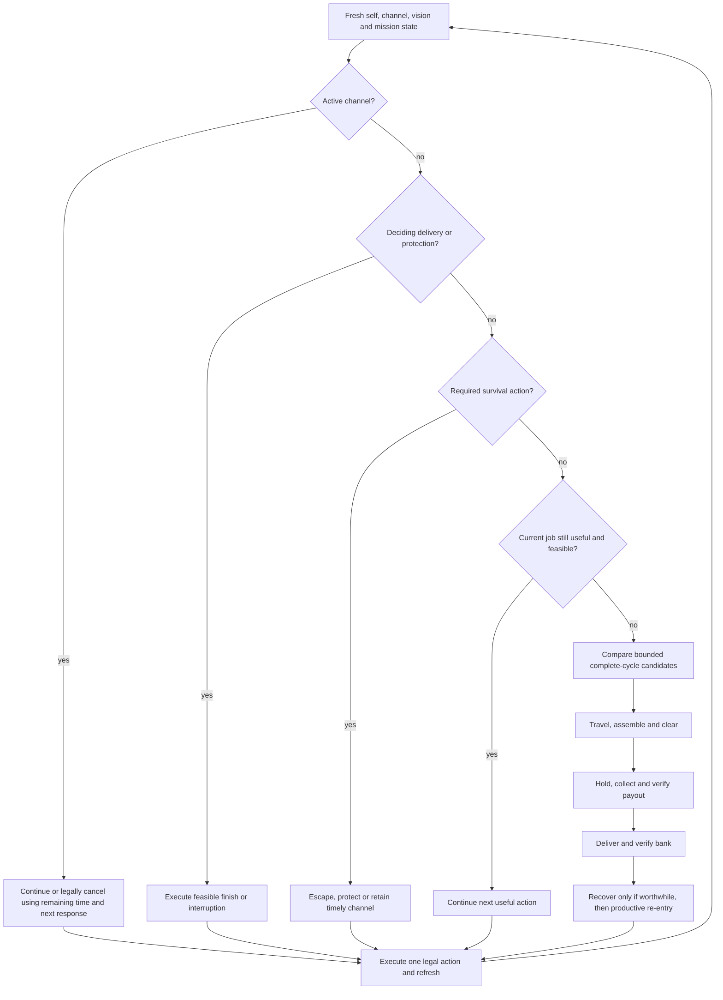

# One decision contract for the resource cycle

**Status: Planned.** This is an implementable first policy specification, not an implementation, a recovered opponent algorithm, or evidence of improved results. Chapters [04](04-vision-and-information.md), [06](06-team-coordination.md), [07](07-combat-and-survival.md) and [11](11-shopping-and-investment.md) remain authoritative for information, team commitments, legal combat sequences and purchases. This contract supplies their common arbitration and the transition from clear to collection, delivery, recovery and useful re-entry.

**Reference:** Current-source statements use `bots/study27-economy/src` at [`dee0fe7`](https://github.com/Javiops/Cambridge-Battlecode-2026/commit/dee0fe7bf464d9f7b281af81f9650135fc541321), with the six bot files reported identical to `a0c0fa2`. The later documentation publication does not establish a live-v43 source match. See [the separate source audit](cycle-source-audit.md). New thresholds below are explicitly inherited reference values, mechanics-derived timing or initial test values. [Twelve current-0.0.2 timing cases and 97 assertions](cycle-timing-current-002.md) confirm the bounded mechanics and API distinctions, not this decision policy. No bot code, upload or competitive test is supplied by this document.

## 1. One owner of the action budget

Each body runs **observe → select mission → check next response → execute one legal action → refresh → continue or release**. Farming, combat, wards, shopping, recovery and locks return proposals to this owner. They cannot independently spend a cast, movement, a reserved consumable or an exclusive action before arbitration. A compatible purchase or free ward can be inserted after its policy authorizes it and before a dependent action; refresh the affected stats/vision afterward. One selected mission can need several compatible actions and different local jobs across actors.

| Decision stage | Required decision | Result |
| --- | --- | --- |
| Lifecycle | Read alive/channel/position/resources. Confirm completion, interruption or death from engine state | Clear impossible jobs; dead-body shopping follows 11; no live contribution from a dead body |
| Active channel | Read its type and remaining ticks; compare completion with an identified threat and a legal cancellation alternative | Continue, or cancel recall/tribute once and refresh; teleport has no manual cancellation |
| Deciding event | Use public banked scores and the earliest feasible conversion/interruption supported by our information | A delivery that wins or improves the actual end result outranks discretionary farming, shopping and PvP |
| Required survival/protection | Compare legal short sequences against the next credible response, including monster exposure, returned damage and linked death | Escape, protect, interrupt or retain a channel that completes before the loss; HP percentage alone cannot cancel a winning channel |
| Existing useful job | Check its lease, actual progress, collector continuity, participants and deadline | Continue if feasible; hard invalidation immediately releases it |
| Ordinary choice | Compare bounded farm, collect, deliver and recover/re-enter candidates | Select one productive cycle with a named next transition |
| Compatible remainder | Re-read action flags and mission reservations | A useful remaining action only; no decorative hit that consumes the escape or delays the deciding channel |

This is a decision order with feasibility guards, not a command to attack every visible enemy before banking. Combat is required when an observed enemy can change the next useful action, or is the selected interception/protection mission. Declining that fight does not authorize the same unsafe camp hit. Completion before the threatening response can be better than cancelling into a losing escape; compare phase order first.

**Current behavior:** Independent pre-sweep/support/kite/front branches can spend actions before this choice, and generic combat precedes banking. Moving them under this contract would be a code change. [Actual order](https://github.com/Javiops/Cambridge-Battlecode-2026/blob/dee0fe7bf464d9f7b281af81f9650135fc541321/bots/study27-economy/src/main.cpp#L2740-L3249), [outer helpers](https://github.com/Javiops/Cambridge-Battlecode-2026/blob/dee0fe7bf464d9f7b281af81f9650135fc541321/bots/study27-economy/src/main.cpp#L3594-L3698).

The arrows describe mission transitions, not permission to spend several incompatible actions without refreshing state. A body can protect a collector while another clears, and an accepted channel can overlap capture only under section 6's continuity guard.

## 2. Local state and evidence that the API can support

Use a local per-body record. The following are conceptual fields, not new shared-memory allocations:

| Field | Contents and acceptance rule |
| --- | --- |
| `epoch` | Current world round plus owner-turn observation/action serial; resuming after fuel suspension invalidates live computations from an earlier epoch |
| `phase` | `UNASSIGNED`, `TRAVEL`, `ASSEMBLE`, `CLEAR`, `COLLECT`, `DELIVER`, `CHANNEL`, `RECOVER`, `REENTER`; phase names do not grant permissions |
| `job` | Stable camp/altar/actor identity, our local role, chosen legal action tile, next task, start, expiry/latest useful action |
| `participants` | Only personally observed timely legal contributors; existing shared claims remain intentions and can price competition, never guaranteed readiness |
| `evidence` | Source, observed round/order, direct observation versus cached estimate versus compact message; unknown fields remain unknown |
| `resources` | Current HP/max HP, gems, personal gold/items, casts/movement/basic flags, restrictions, cooldowns and required reserve action |
| `progress` | Last actual move/useful damage, lifecycle transition, verified occupancy history, accepted channel start and completion/interruption evidence |
| `failures` | Last failed action/route, cause if known, last changed condition and bounded retry/alternate count |

**Important API boundary:** The audited cached C++ SDK exposes camp lifecycle `alive`, `reward_available`, and `respawning(timer)`, gated by personal effective vision of an original spawn tile. It does **not** expose capture owner or capture countdown in this interface. Do not implement an imaginary `capture_timer()` call or read omniscient replay progress. Track only occupancy-phase bounds justified by actual continuity; a missed phase, empty/contested region or loss of required visibility makes unsupported bounds unknown. The current engine's actual public queries confirm that state 2 stays unchanged before capture, during progress and after contest reset. An elective overlap needs the [explicit timing/continuity guard](#6-channels-deadlines-and-exact-outcomes); otherwise finish payout first or use a real holder handoff. The current bot's `cap_start` is a local heuristic, not engine capture progress. A visible champion's `remaining_channel_time()` and public `global_submitted_gems(team)` do exist in the audited SDK. Verify the implementation engine/SDK pin before coding.

Observe our post-purchase HP and maximum HP together. An observation snapshot and remembered buff collection do not refresh themselves after an action. Remote ally HP/position and private enemy cooldowns cannot be inferred from a team roster handle. A legal targeted action needs our own current target visibility; an evidence-based ground cast follows 07's separate rule. The host's full replay state is research evidence, not bot knowledge.

## 3. Geometry and bounded candidate construction

Cache immutable terrain, original spawn masks, camp membership/rewards/ranges, altar rings, and walking distances. Keep occupancy, personal vision, danger, live monster state and action readiness dynamic. Features are numbers/masks, not official map names:

- Compute travel to a **legal useful action tile**, capture spawn tile or adjacent tribute tile; use walking distance, with the action allowance needed after arrival. A straight line through a wall is not a contribution ETA.
- Compare our and enemy spawn-route times to each objective and its exits. Short opposing arrival, shared choke crossings, sparse exits and low warning time make a job contested; absolute map size or a remembered map label does not.
- Distinguish harmless clusters from damaging camps, single-region rewards from a monolith-only gem economy, available adjacent altars from distant conversion routes, and safe-side staging from occupied spawn tiles that delay respawn.
- Compare direct delivery with recall + necessary spawn recovery/purchase + walking to a legal altar tile. Home changes channel time, not walking time. Crystal proposals include their own channel and landing legality; they are not free path edges.
- A feature result can be known feasible, known infeasible or unknown. An unseen map is **unknown, not automatically unsafe**. Reversible observation or productive safe-side travel can reduce uncertainty. Do not start an irreversible wake/channel whose required survival or continuity condition has no support.

First implementation limits are **initial test values**: at most three camp jobs (incumbent, best fresh waiting reward, best other productive camp), two altar candidates, and one recovery/re-entry plan per decision. Score immutable coarse candidates first; perform the expensive dynamic check only on this shortlist. For staffing use the solo, pair and available larger group comparisons of 06; do not enumerate all team partitions. Missing shortlist/path data preserves the current useful job or uses bounded observation/recovery rather than assuming a route exists.

## 4. Compare complete cycles without double counting

Each candidate returns `eligible`, `first_useful_time`, `reward/finish_time`, `next_job`, `required_actions/participants`, `survival_or_interrupt_window`, `observation_quality`, `failure_fallback`, and `cost_terms`. Reject a known impossible deadline/route/required action before scoring. Unknown is retained separately, not converted to zero risk or zero value.

The ordinary comparator is a coarse **secured-value per occupied-time** estimate. For the first local implementation compare each route through its next completed bank: `(current bag + newly collected personal gems + w × newly earned personal gold) / max(1, elapsed owner-opportunity time to that bank and required recovery)`, with the source's `w=0.25` before round 600 and 0.24 afterward retained only as a heuristic fallback. Include travel, assembly, legal clear actions, capture phases, conversion and incremental heal/shop/re-entry; use actual interleaved phases to convert owner opportunities to deadlines. Bank-now and one-reward-then-bank each include the current bag exactly once. An elective recovery candidate must append a feasible next productive job to the same completed-bank endpoint; it does not receive fictitious gems for healing. Necessary recovery is governed by survival feasibility before the ordinary rate comparison. If no next-bank estimate is supported, retain the existing useful job or the stated threshold fallback instead of manufacturing a score. These weights and this endpoint comparator are Planned, not validated optimal settings.

Keep the chosen collector's personal allocation and every helper's best forgone feasible job visible. For the first local implementation a helper joins only when its timely contribution changes the mission feasibility or beats that alternative under 06; do not add one reward to every helper's numerator. Price only incremental recovery already avoided or added: do not charge a necessary heal twice or call an elective trip free because capture overlaps recall. In a known gold-only remaining horizon, use the official tiebreak objective rather than assigning impossible future tribute to that job.

Keep current bag protection and new reward separate. A candidate that banks 24 existing gems and obtains 24 new gems must not count the existing 24 once as carried value and again as new income. Count a shared camp's reward once for the group; preserve personal gold for 11's purchase decision. With no credible survival probability model, do not manufacture numeric probabilities: use feasible/unknown/infeasible response checks plus explicit timing/damage bounds. A theoretical positive rate does not override a deciding bank or hard continuity/survival guard.

For ordinary delivery, compare **bank now** with **one additional feasible reward then bank**. Include longer tribute ticks from the starting bag, route/interception exposure, collection continuity and the end deadline. Chain only when the extra job still allows conversion and beats bank-now after these costs; then re-evaluate after that one reward. Do not permit a fresh chain choice every turn to defer banking indefinitely. Initial fallback bag triggers remain the reference 12 gems, 10 within distance 8, and 5 within distance 2, plus late round 1850; these are source-derived heuristics, not universal optimums. New policy removes map-name overrides: any increased bag target requires an explicit demonstrated route/time advantage, or keeps this common fallback.

For recall, ask what changes the **next mission**: necessary survival/ability to clear, or a legal useful purchase chosen by 11. Compare direct field continuation/delivery with recall, actual heal timing, installed upgrade and return ETA. Tavi gold alone is not a recall reason. A 55% HP ordinary-recovery trigger, 25%/35% emergency floors and 95% spawn fallback are inherited source values; actual lethal response or a mission-specific requirement overrides them. An optional shopping trip with unknown return feasibility is declined while necessary recovery still remains available.

## 5. State transitions, collectors and leases

| Phase | Enter only when | Continue / transition | Abort / fallback |
| --- | --- | --- | --- |
| `TRAVEL` | Useful job and reachable contribution/collection tile selected | Refresh on arrival/new sight; go to assemble, clear, collect or deliver | Hard threat, closed route, lost reward or missed latest action releases the job |
| `ASSEMBLE` | Required contribution missing but can credibly arrive within a bounded start window | Wait outside actual monster/enemy reach; start only with observed ready contributions | Latest useful start or maximum assembly wait reached: smaller camp, safe work or recover |
| `CLEAR` | Camp lifecycle and legal sequence support a viable clear/collection path | Requery after each action; preserve the specific escape/control action required by next response; final monster death is followed by lifecycle verification | Lost participant, unsafe reply, no safe collector/exit or stalled clear: stage, protect or abandon; sunk damage is no exemption |
| `COLLECT` | Fresh waiting reward and our physical holding role | Keep continuous uncontested required occupancy; retain last holder until payout or actual overlap; excess clearer leaves only toward a useful legal exit | Safety can explicitly abort; unknown/contested progress is not completion; a claim within four tiles never replaces a holder |
| `DELIVER` | Positive real bag and chosen feasible altar plan | Go to selected legal ring tile; lock change reopens remove/reroute comparison; start once, verify actual channel | Blocked/unsafe/unfinishable plan: other legal altar, preserve bag, recover or purposeful work; no repeated locked-altar submit loop |
| `CHANNEL` | Engine confirms channel type/start | Read remaining ticks and actual type; continue when completion remains the best feasible outcome | Recall/tribute cancellation only when legal and useful; TP cannot cancel; on interruption refresh before retry |
| `RECOVER` | Survival need or valued elective trip | Heal/shop under 11, refresh HP/max HP, then select useful re-entry | Failed channel or shop refreshes state; no successful-recovery claim from an attempted command |
| `REENTER` | Alive and ready enough for chosen legal next job | Count as support only when it can act before the job's window; then travel/clear/protect | Old target deadline expired: choose fresh useful work, never automatically return into the death location |

Select a collector before clearing when actual local evidence supports the assignment: earliest viable occupant through payout, personal next useful purchase where known, lower escape/bag risk, then stable body ID. Transfer only when the gain beats the absence/continuity cost. Lack of remote wallets prevents remote exact-purchase optimization. An existing viable sole holder stays when the benefit of transfer is unresolved.

**Acyclic local handoff, v1 initial design:** a redundant on-region holder may yield only to a personally visible eligible on-region actor with a **lower stable body ID** and a matching existing camp intention, plus an immediately legal purposeful exit no worse under the response check. Eligible means living, not recalling/tributing/teleporting, sufficient current HP for the checked response, and no observed restriction forcing departure; use the reference 35% eligibility floor only as an inherited fallback. If that actor's intention cannot be represented/read in the retained claim layout, keep holding rather than infer acceptance. The lowest eligible ID cannot voluntarily yield merely because another holder is present, so reciprocal yield decisions cannot empty the region through this rule alone. This is a deterministic continuity fallback, not an optimal income-allocation claim or an accepted future hold promise. Hard safety/deciding-event aborts can still remove the last holder explicitly. More flexible personal-upgrade transfers require the separate fresh acceptance/lease design of 06.8.

**Lease policy:** keep the incumbent travel/cycle job for six world rounds unless a hard invalidation occurs; on expiry re-score, and switch ordinary jobs only for an estimated rate improvement above 25%. These are inherited scales from six-round retargeting and the reference 1.25 target bonus, repurposed as **initial test settings**, not proven equivalent or optimal. Assembly maximum is six world rounds as an **initial test value**, shortened by the actual latest useful start. Clear rechecks after every action and renews only on observable useful progress; two owner turns without useful progress trigger replan as an **initial test value**. Capture does not expire out from under the last holder: a lease expiry requests a fresh outcome/continuity check, not automatic departure. Channel timing is always its actual remaining ticks, never the six-round job lease.

Hard invalidations override every ordinary lease immediately: imminent relevant lethal response, lost essential participant, illegal/lost target, blocked required route, enemy contest, confirmed reward/mission completion or missed deciding deadline. A minor HP/score fluctuation is not one. Release our stale camp intention when the body leaves for bank/recovery/death/protection; existing remote claims can still be stale and never certify support.

## 6. Channels, deadlines and exact outcomes

Use owner phases, not `round + duration` guesses. Normal recall uses five owner-turn-end ticks, Home three; tribute uses `max(1, ceil(start_bag/10))` under the audited rules; crystal uses three. Starting turn end counts. Zero remaining countdown stays pending until the next owner start. Capture resolves before channel completion in the retained mechanics evidence. A capture reward gained while submitting can join the eventual whole-bag conversion without increasing the initial duration, but only if actual occupancy/phase continuity delivers it in time.

Recall is interrupted by damage, stun or death; tribute by stun/death/enemy lock, not ordinary damage; crystal by enemy stun/death, not ordinary damage. Recall and tribute support manual cancellation; crystal does not. Re-read actual restrictions and channel state instead of applying a generic danger cancel. A lock placement/attack and a submit attempt are distinct from tribute acceptance and score completion.

**Deciding delivery authority is 09.8.** Query public banked score and use the actual match horizon. A legal current delivery reaching 1000 before the credible competing event wins preference over routine chores. Near the limit, include route actions, lock hits, occupancy, countdown ends and next owner start; an action beginning before round 2000 can still finish too late. Use official tiebreak order when no further completed tribute is feasible: banked gems, lifetime gold, kills, then Team B for a full tie. Where a tiebreak statistic is not exposed to the bot, keep it unknown; an evaluator's host statistic does not become a bot input. Enemy future bags/paths without evidence remain unknown, so no fabricated guaranteed win/intercept claim is allowed.

**Guarded capture overlap, v1 Planned:** preserve the verified timing benefit when continuity can be established. The current controlled cases collect before departure when normal five-tick recall starts after one prior hold interval, or Home three-tick recall after three. Immediate normal recall and one-hold Home recall lose the reward. The nominal prior hold is `max(0, capture_time + 1 − recall_duration)` under these verified phases; it is a mechanics-derived bound, not an economic optimum. Use a fresh waiting-reward observation, actual position and local continuous-hold history; inventory-derived duration must match actual public remaining time after accepted start. If it unexpectedly differs, cancel legally and refresh before relying on the old departure window.

The first narrow geometry guard is a **single-spawn-tile group**: our uninterrupted living presence prevents ordinary enemy entry to the occupied region, as an actual current-engine move rejection confirms. Still require the full recall survival/interruption check, no forced departure, the nominal hold, current channel/position validation and worthwhile recovery/re-entry. The tested normal single-tile case succeeds; Home's timing plus this occupancy guard is a mechanics-based combination whose policy implementation remains Planned. For multi-tile groups, initial hold alone is insufficient: an enemy can enter another spawn tile and reset capture without interrupting recall. Permit a broader overlap only with an explicit supported continuity/contest bound or actual replacement satisfying the acyclic handoff rule. Never read the host capture timer as that bound.

**When continuity is unverified, payout first is the fallback.** Intermittent owner snapshots can miss contest/reset, and public reward state 2 does not reveal it. This fallback has a cost: in the uncontested controlled setup it delays departure by five normal or three Home owner intervals relative to successful overlap. It may lower income or recovery timing, and is not claimed universally better than the reference. Keep guarded-overlap and fallback variants as an explicit comparison. Necessary survival can still abort the capture. See [current timing and exact counterexamples](cycle-timing-current-002.md).

After a channel start attempt, classify `STARTED`, `MOVED_ONLY`, `LOCK_HIT`, `REJECTED`, `INTERRUPTED`, or `COMPLETED` from actual state/outcome. The current go-tribute helper's handled movement is not proof of `STARTED`. A score increase and our own matching bag change support completed conversion; ambiguous attribution remains ambiguous.

## 7. Fuel, eight bytes and failure behavior

Version one adds **no shared bytes**. Existing bytes 0–4 hold claims, 5–6 lifecycle, 7 danger. Packed-six claims work only with the source's exact six-body/at-most-63-groups condition; otherwise degrade explicitly rather than losing a sixth actor. A claim has no freshness field. Danger can alias after its modulo wrap; two lifecycle writes are not an atomic accepted promise. A remote role/ETA/lease protocol requires 06.8's separate encoding, ownership, migration, freshness and suspension design.

Preserve the source 6000 fuel reserve as a starting guard, not a measured worst-case budget. Current ordinary planning requires more than 21000 remaining fuel, and walking altar planning more than 56000. New shortlist construction must stop before its allotted work plus execution/refresh reserve. Immutable fields may resume construction, but each live proposal/action re-reads epoch, self/channel state and relevant target visibility on resumption. Never finish an old read-modify-write or stale sequence merely because execution resumes at its next instruction. Measure actual guest costs; the unmetered native visualizer proves no fuel bound.

Initial failure budget: one channel start attempt per owner decision; after a rejected move, refresh revealed occupancy and try at most two different legal alternatives (**initial test values**), then change route/job or hold if holding is useful. A failed action never advances the phase. A retry on a later turn requires a changed relevant condition or a fresh validated alternative, rather than the same impossible command. On fuel exhaustion of planning, keep a still-valid channel/holder; otherwise perform the already validated lower-threat local action or bounded safe-side observation. Do not blindly call the old farm helper after rejecting farming for safety.

Record one compact transition/rejection reason with objective, epoch, evidence age, accepted action, hard-abort/lease reason and next phase. Log attempts and completions separately. This diagnostic is local; no extra byte protocol is smuggled in through logging.

## 8. Implementation boundary and required validation

First implement fresh state and semantic action results, common action-budget arbitration, bounded local readiness, safe camp expenditure, real holder continuity, one-reward chain versus bank, and mission-priced recovery/re-entry. Keep draft, ward selection, remote coordination protocol and purchase-family optimization within their existing authorities. Crystal use and smarter locks can remain optional proposals until their own rules/tests exist; they must not be approximated by ordinary recall.

Required scenarios include: visible enemy that cannot affect farming; enemy that can punish the next camp hit; shield/escape cast reserved instead of camp damage; missing/late/dead helper; helper already on the region versus merely claiming within four; last holder and Home recall; capture progress becoming unknown; reward while tribute is active; ordinary damage versus stun/lock interruption; blocked movement revealing a hidden occupant; rejected channel with movement still available; current bag winning without another camp; deadline miss despite an early channel start; necessary versus elective recall; Tavi gold-only trip; post-shop maximum HP; monolith-only gem economy; six-body claims; and suspension between planning and action.

Compare baseline, arbitration-only, cycle-only and their combination on identical engine/source identities, development maps/sides/opponents, then untouched generated maps and several opponent styles. Check activations, completed personal/team resource flow, lost bags, collection continuity, idle/assembly time, return cost and fuel. Replays suggest opportunities but cannot establish this policy's causal effect. Promotion remains Planned until implementation matches and comparative evidence supports it.
