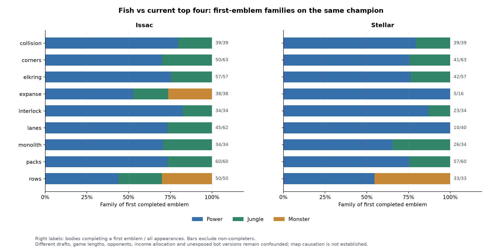
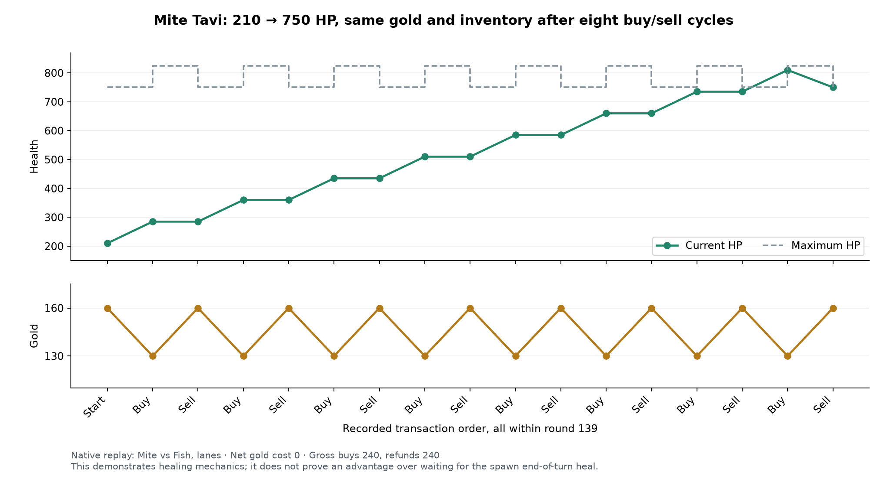

# Shopping strategy research — 16 October 2026

[Operational tactics: Chapter 11](11-shopping-and-investment.md)

Our proposed starting point is **invest for the next useful mission breakpoint, and price the trip separately from the purchase**. Preserve each body's private budget, first-copy passive effects and completion state. A strong team's repeated item order motivates a test; it does not establish a globally optimal build.

This report covers exactly the same frozen elite games as the [ward study](ward-research-2026-10-16.md). It separates confirmed transactions, verified rules, observed associations and our original planned policy. The top four at that snapshot are **Intercontinental Fish, Sneaky Bush Campers, Mite and Univardisty of Shingtonwash**. Short team names below refer to those names; Quantom is ❤️Quantom❤️.

The 2,119 distinct native raw streams contain **167,011 confirmed shop transactions**: 155,467 item buys (357,296 charged shards) and 11,544 consumable buys. Five shards automatically form one emblem; the 63,744 observed emblem completions are not additional purchases. Native before/after gold, inventory and catalog costs confirm each buy. No XP or champion levels exist in this engine: item points, HP and effective Strength/Focus are recorded separately.

## Scope and reconstruction

This is exactly the frozen ward cohort: 3,766 API game IDs, 2,119 distinct raw SHA-256 streams, 4,238 team/game observations and 21,312 champion-body/game appearances. Extra IDs alias 1,647 already counted streams. The frozen top-four head-to-head subset is 2,460 IDs / 1,078 streams. Ranks refer to the 2026-10-15 22:51:52 UTC ladder snapshot; selected game creation times span 13 October 16:10 to 15 October 22:50:49 UTC. All nine maps are covered. No outcome filter was used. Distinct streams are not asserted to be independent bot versions, and private submission/version fields are unavailable.

The scanner uses the pinned official WASM (`ce302dc6666ae43592f6936e572bc4baca92a345bff13ef7f986609ac666a0dc`) and sequential native ReplayNext states. It captures the exact state immediately before and after each resource command, full initial/final roster, alive owner-turn-start gold/shop-location observations, and complete-roster checkpoints every 25 rounds. Gold/items are personal, including separate Cassi and Issac budgets. Team totals below sum those budgets. Gold exists from rewards and recipient-specific bonuses; there is no passive income or starting gold.

## All ten teams: spending, saving and batch size

| Team | Streams / bodies | Earned gold | Item / consumable gross spend | Net / earned | Final gold | No item buy bodies | Median item batch |
| --- | --- | --- | --- | --- | --- | --- | --- |
| Fish | 567 / 2,938 | 1,719,340 | 1,583,670 / 0 | 92.11% | 135,670 | 356 / 2,938 | 3 |
| Sneaky | 380 / 1,876 | 933,445 | 844,950 / 0 | 90.52% | 88,495 | 401 / 1,876 | 3 |
| Mite | 1,011 / 5,295 | 2,975,025 | 2,642,160 / 43,800 | 90.26% | 289,725 | 652 / 5,295 | 3 |
| Univardisty | 821 / 4,037 | 2,230,537 | 1,994,370 / 60,290 | 92.12% | 175,877 | 449 / 4,037 | 3 |
| VeryGood | 227 / 1,176 | 577,880 | 525,330 / 0 | 90.91% | 52,550 | 178 / 1,176 | 1 |
| Quantom | 264 / 1,233 | 781,280 | 703,890 / 4,260 | 90.64% | 73,130 | 83 / 1,233 | 1 |
| hello | 264 / 1,321 | 715,194 | 642,510 / 6,910 | 90.80% | 65,774 | 194 / 1,321 | 3 |
| Nyxius | 243 / 1,196 | 708,725 | 587,610 / 0 | 82.91% | 121,115 | 269 / 1,196 | 3 |
| geese geese go | 221 / 1,087 | 610,664 | 565,650 / 0 | 92.63% | 45,014 | 122 / 1,087 | 1 |
| Full Damage | 240 / 1,153 | 677,395 | 628,740 / 180 | 92.84% | 48,475 | 155 / 1,153 | 1 |

Across the cohort, earned gold is 11,929,485; gross spend 10,834,320; refunds 660; net spend 10,833,660; final gold 1,095,825. Every personal ledger balances: initial gold + earned + refunds − gross spend = final gold. Gross spend counts health-shard purchases subsequently refunded by Tavi; net spend removes the refunds. Spending totals are duration- and reward-dependent, not efficiency or win-effect estimates.

Single-shard commands are prominent for VeryGood, geese geese go and Full Damage; each has exactly one shard per item transaction. First/second/third command rounds can therefore coincide or have misleadingly different medians. A 150-gold completed emblem is the comparable build milestone; it may be assembled through several commands or one five-shard batch.

## Strongest opponents and purchase timing

All rows here are top-four versus top-four. Cells show median round **(number of bodies reaching that transaction or milestone)**; each column has its own denominator. Transaction rounds are item buys, not individual shards. Bodies that never reach a milestone remain in the reported total bodies but not its timing median.

| Team | Streams / bodies | Item buy 1 / 2 / 3 | Emblem 1 / 2 / 3 | Net / earned |
| --- | --- | --- | --- | --- |
| Fish | 437 / 2264 | 111 (1,977) / 148 (1,740) / 211 (1,492) | 135 (1,719) / 223 (1,317) / 256 (1,055) | 92.30% |
| Sneaky | 221 / 1102 | 93 (850) / 171.5 (674) / 222 (594) | 143 (690) / 236 (521) / 288 (414) | 91.45% |
| Mite | 839 / 4414 | 120 (3,846) / 170 (3,275) / 225 (2,817) | 150 (3,268) / 248 (2,445) / 290 (1,983) | 90.64% |
| Univardisty | 659 / 3247 | 102 (2,854) / 173 (2,339) / 222 (1,929) | 140 (2,241) / 231 (1,646) / 272 (1,326) | 92.16% |

The latest sensitivity slice selects the newest two match IDs by timestamp then ID within each unordered team pair × map × game kind, before raw-hash deduplication. It has 1,513 IDs / 1,174 raw streams. Its intersection with top-four head-to-head has **133 raw streams**; the four team appearances below sum to 266.

| Team | Recent h2h streams / bodies | First item buy: all h2h → recent | First emblem: all h2h → recent | Net / earned: all h2h → recent |
| --- | --- | --- | --- | --- |
| Fish | 62 / 312 | 111 (1,977) → 112 (279) | 135 (1,719) → 125.5 (248) | 92.30% → 92.48% |
| Sneaky | 64 / 304 | 93 (850) → 81 (248) | 143 (690) → 127 (212) | 91.45% → 90.76% |
| Mite | 84 / 426 | 120 (3,846) → 113 (382) | 150 (3,268) → 158 (342) | 90.64% → 86.35% |
| Univardisty | 56 / 276 | 102 (2,854) → 100.5 (264) | 140 (2,241) → 149.5 (220) | 92.16% → 92.31% |

The recent comparison preserves Mite’s Jungle-first pattern (all 342 recent first emblems are Jungle: 193 Strength, 149 Focus) and Univardisty’s mixture of Power, Bruiser and Treasure. Timing and saved-gold levels change: Mite’s recent net-spend fraction falls, while first-emblem timing shifts in different directions across teams. Fish’s Jungle share of first emblems falls from 418/1,719 in all h2h to 18/248 recently; Monster rises from 98/1,719 to 53/248. Those changes make a single all-history “current policy” label unsafe. Map, chronology, opponent, draft and private versions remain confounded even within a team/champion.

## Build composition and champion conditioning

| Team | Power | Durability | Bruiser | Jungle | Monster | Treasure | Home |
| --- | --- | --- | --- | --- | --- | --- | --- |
| Fish | 972,090 | 261,420 | 190,140 | 101,130 | 58,890 | 0 | 0 |
| Sneaky | 497,790 | 134,490 | 86,190 | 125,070 | 1,410 | 0 | 0 |
| Mite | 1,159,740 | 466,500 | 370,260 | 645,000 | 0 | 660 | 0 |
| Univardisty | 1,427,910 | 359,190 | 138,840 | 0 | 0 | 68,430 | 0 |

These are gross gold by item family. **Mite’s 660 Treasure gold is entirely 22 temporary Treasure Health shard purchases, each immediately sold for a 30-gold refund; no Treasure emblem or Treasure bonus income results.** Its retained Treasure investment is zero. Across all ten teams Home purchases are zero. Univardisty spends 68,430 on Treasure and records 30,254 Treasure bonus gold; those are separate descriptive flows, not a causal return-on-investment estimate. The `treasureGold` field tracks Treasure-item bonus only, excluding Vesper’s passive bonus. Camp reward splitting occurs before each recipient’s bonuses; team totals do not imply transfers to teammates.

Among bodies completing a first emblem, Mite is exactly Jungle Strength 2,257 / Jungle Focus 1,717. Univardisty’s first completions are Power Strength 935, Power Focus 730, Bruiser Health 720, Treasure Focus 388 and Bruiser Strength 96. Fish and Sneaky mix families more broadly; their composition changes with champion and cohort.

| Team / champion | Body appearances | No item buy | Most common first completion (count / all first completions) | Most common first-three emblem sequence (count) |
| --- | --- | --- | --- | --- |
| Fish / Issac | 567 | 16 | Power Emblem of Strength (378 / 525) | Power Emblem of Strength → Durability Emblem of Health → Power Emblem of Strength (252) |
| Fish / Stellar | 493 | 60 | Power Emblem of Focus (276 / 356) | Power Emblem of Focus → Durability Emblem of Health → Power Emblem of Focus (124) |
| Sneaky / Issac | 312 | 81 | Jungle Emblem of Strength (104 / 207) | Jungle Emblem of Strength → Durability Emblem of Strength → Bruiser Emblem of Health (81) |
| Sneaky / Stellar | 379 | 88 | Power Emblem of Focus (241 / 241) | Power Emblem of Focus → Jungle Emblem of Focus → Durability Emblem of Focus (96) |
| Sneaky / Tavi | 273 | 35 | Jungle Emblem of Focus (144 / 193) | Jungle Emblem of Focus → Durability Emblem of Focus → Bruiser Emblem of Health (73) |
| Mite / Issac | 1011 | 125 | Jungle Emblem of Strength (802 / 802) | Jungle Emblem of Strength → Durability Emblem of Strength → Bruiser Emblem of Health (393) |
| Mite / Stellar | 707 | 104 | Jungle Emblem of Focus (473 / 473) | Jungle Emblem of Focus → Durability Emblem of Focus → Bruiser Emblem of Health (239) |
| Mite / Tavi | 261 | 42 | Jungle Emblem of Focus (121 / 161) | Jungle Emblem of Focus → Durability Emblem of Focus → Bruiser Emblem of Health (24) |
| Univardisty / Issac | 580 | 61 | Power Emblem of Strength (426 / 442) | Power Emblem of Strength → Durability Emblem of Health → Power Emblem of Strength (270) |
| Univardisty / Stellar | 700 | 40 | Power Emblem of Focus (539 / 539) | Power Emblem of Focus → Durability Emblem of Health → Power Emblem of Focus (292) |
| Univardisty / Tavi | 593 | 47 | Treasure Emblem of Focus (388 / 409) | Treasure Emblem of Focus → Durability Emblem of Focus → Power Emblem of Focus (218) |

Repeated emblems still add their stat points; the same family’s passive is not multiplied by owning it across stats or copies. `batchStatEffectPer30Gold` preserves actual observed batch stat/HP gains grouped by champion, stat and prior-points bucket. It is not a per-point marginal curve or evidence that a particular extra purchase improved the result.

## Nine maps with the champion held fixed

Fish/Issac appears on every map and avoids mixing different champion drafts. Counts below condition on the first completed emblem; the body column includes non-completers. These are observed map associations, not proof of map adaptation. Full team × champion × map tables for all ten teams and each temporal slice are in `conditional-builds.csv` and `current-summary.json`.

| Map | Bodies / first completions | Power Strength | Jungle Strength | Monster Strength | Jungle Health | First item buy round (n) |
| --- | --- | --- | --- | --- | --- | --- |
| collision | 55 / 55 | 46 | 8 | 0 | 1 | 59 (55) |
| corners | 80 / 63 | 46 | 15 | 0 | 2 | 86 (75) |
| elkring | 73 / 73 | 59 | 13 | 0 | 1 | 34 (73) |
| expanse | 49 / 48 | 23 | 7 | 16 | 2 | 76 (49) |
| interlock | 47 / 47 | 40 | 5 | 0 | 2 | 37 (47) |
| lanes | 79 / 55 | 43 | 10 | 0 | 2 | 147.5 (68) |
| monolith | 49 / 49 | 38 | 9 | 0 | 2 | 37 (49) |
| packs | 74 / 74 | 56 | 15 | 0 | 3 | 46 (74) |
| rows | 61 / 61 | 27 | 13 | 19 | 2 | 88 (61) |

Fish/Issac’s Monster-first completions occur on expanse (16/48) and rows (19/61); Fish/Stellar also records Monster Focus first on rows (19/40 first completions). This remains chronology-confounded, especially given the recent Fish family shift. Absence in one group is descriptive; no geometric or economic cause is inferred. Map-specific game duration and surviving income opportunities also affect timing and completion rates.

## Shop context, unspent gold and consumables

| Team | Item buys in own spawn | Item buys while dead | Alive field item buys (all Tavi) | No spend / zero earned | No item buy despite ≥30 lifetime earned | No spend with ≥150 final gold |
| --- | --- | --- | --- | --- | --- | --- |
| Fish | 17,017 | 1,034 | 0 | 262 | 94 | 11 |
| Sneaky | 5,891 | 1,032 | 1,136 | 358 | 43 | 20 |
| Mite | 24,233 | 0 | 796 | 512 | 139 | 55 |
| Univardisty | 13,263 | 1,077 | 2,950 | 362 | 87 | 9 |

Exact pre-transaction snapshots distinguish alive/dead, then half-open embedded spawn rectangles. Every confirmed item buy has official item CanShop=true; every alive field item buy is Tavi. Dead bodies can shop, so alive owner-turn-start counters omit a real purchase opportunity class. First observed gold ≥30 is not necessarily immediately spendable: the alive first eligible owner-start median is Fish 112, Sneaky 93, Mite 116, Univardisty 103, versus first item-buy medians 111/87/117/103. Within-turn reward arrival and dead shopping can make a purchase precede the first sampled alive eligible start. These counters do not measure every legal microstate or establish avoidable delay. A round-one spawn observation is initial placement, not a return; later observed returns and preceding recall commands are retained separately. Recorded recall commands do not prove a successful recall.

Most top-four bodies with no spending earned no gold at all (262 Fish, 358 Sneaky, 512 Mite, 362 Univardisty). Some funded bodies end without item purchases, but neither lifetime affordability nor final gold establishes an actionable missed buy. Opportunity counters sample alive turn starts and are right-censored at game end. Whole-team leftover gold is a sum of private balances, not a transferable pool.

| Team | Altar locks bought / used | Teleport crystals bought / used |
| --- | --- | --- |
| Fish | 0 / 0 | 0 / 0 |
| Sneaky | 0 / 0 | 0 / 0 |
| Mite | 4380 / 2473 | 0 / 0 |
| Univardisty | 6029 / 3355 | 0 / 0 |
| VeryGood | 0 / 0 | 0 / 0 |
| Quantom | 426 / 12 | 0 / 0 |
| hello | 691 / 65 | 0 / 0 |
| Nyxius | 0 / 0 | 0 / 0 |
| geese geese go | 0 / 0 | 0 / 0 |
| Full Damage | 0 / 0 | 18 / 0 |

All consumable purchases are confirmed inventory increases with ten-gold cost each. A use is a native inventory decrement, not proof of strategic value or successful objective protection. Mite’s 4,380 lock purchases all occur alive in its spawn rectangle; Univardisty’s 6,029 include 851 while dead. No alive field consumable purchase occurs. Fish and Sneaky buy none in this cohort. Full Damage’s 18 Teleport crystals have no observed use before the replay ends; unused units are inventory, not an inferred mistake.

## Source-bound transaction examples

Nine compact exports in `cases/index.json` retain exact before/after actor state, match, map, round, input, coordinates, source SHA and replay URL. Examples include Mite versus Univardisty on packs: R25 input545 buys five Jungle Focus shards (150g), and R27 input585 buys five Power Strength shards (150g). Fish examples include monolith R37 input933 Power Strength and collision R42 input599 Bruiser Health. They illustrate actual transitions, not optimality.

The exceptional Tavi case is Mite versus Fish, lanes, `17a5c872-dd06-4e5d-b6af-13c0dfaec889`, R139 actor 4, inputs 4292–4307. Eight consecutive Treasure Health shard buy/sell pairs leave inventory, maxHP and 160 gold unchanged but raise current HP from 210/750 to750/750. Each buy temporarily raises current and maximum HP; each full-price sale reduces maximum HP while preserving current HP up to the new maximum. The next inputs buy five Jungle Focus shards for 150 and an altar lock for 10. The five sale-containing streams have 22 such immediate pairs; all 22 gain HP, totaling 1,462 observed HP across pairs. This is mechanically effective healing, not evidence of private intent or match-winning causality. An independent bounded mechanics fixture reproduces the 210→750 interaction. See `health-refund-cycles.json` and `cases/tavi-health-refund-cycle.json`.

## Audit and reuse boundaries

`current-audit.json` passes with zero errors across all 2,119 streams and 21,312 personal ledgers. Source hashes, roster/final native–API values, gold conservation, all confirmed costs and cross-body resource deltas are checked. There are zero other-body resource changes during confirmed resource transactions. Root’s independent `../transaction-audit.json` also passes all 175,832 candidate events and reconstructs all 42 API item counters, including automatic emblems. The API baseline independently agrees on team totals. All 22 sales are Tavi, one negative item change, exact full-face-value refund; they explain all five initial residual games. Native sale tag 25 was added after the first pass and only those five streams were replayed; `sale-repair-ledger.json` preserves old/new evidence hashes. The other 2,894 tag 16 events have no gold or inventory delta and are not counted as failed purchases.

This study reconstructs public outcomes, commands and state changes. It cannot observe the private shop policy, intended build, rejected commands outside the native stream, counterfactual opportunity cost, or whether a purchase caused a win. Rankings, map mix, chronology, opponent, role, draft composition and game duration may explain differences. Read small champion/map samples with their explicit denominators. Sparse checkpoints and owner-turn-start availability are samples; transaction pre/post states and final ledgers are exact within the pinned decoder.

Authoritative outputs: `current-summary.json`, `current-audit.json`, `team-summary.csv`, `map-team-summary.csv`, `conditional-builds.csv`, `body-ledgers.{csv,jsonl.gz}`, `team-game-ledgers.{csv,jsonl.gz}`, `purchase-events.csv`, `purchase-context.csv`, `checkpoints.csv`, `cases/index.json`, `health-refund-cycles.json`, and `sale-repair-ledger.json`. Source bindings use the same ward manifests. Keep the API accounting baseline, independent transaction audit, mechanics metadata/probes and methods/summary reviews with the evidence package.

## Map and champion contrasts in a visual comparison

This figure uses the top-four head-to-head subset. Right labels are first-emblem completers / all body appearances, and bars condition on completion. It deliberately holds the team and champion fixed. That removes one draft confound, but not game duration, income allocation, opponent, role, chronology or unexposed source versions. A small five-completer sample is not given the same evidential weight as a 60-completer sample.

The most useful conclusions are narrower than “build X on map Y.” Fish's Monster-first examples on rows and expanse motivate testing camp-throughput investment on routes where that multiplier changes the clear cycle. Mite's stable Jungle-first opening motivates testing camp-sustain before expensive monster exposure. Univardisty's Tavi Treasure opening motivates testing an economy purchase on a body that can convert future gold into field equipment without another trip. These are proposed mechanisms to test, not inferred private intent.

For unseen maps, derive the shopping horizon from the actual reachable resource route, expected incoming damage, enemy reinforcement time, next tribute opportunity and spawn-to-mission path. A big map can make returns expensive, but dimensions alone do not tell us the actual path or whether Tavi needs a return at all. A harmless-cluster route does not need the same Jungle insurance as a route where the owner tanks repeated monsters. The [adaptive-build table](11-shopping-and-investment.md#7-adaptive-builds) specifies these feature-based decisions.

## Verified rules and investment mathematics

The [official Items & gold article](https://2026a.battlecode.co.uk/game/docs/items), [API](https://2026a.battlecode.co.uk/game/api), SDK/CLI **2.1.6**, and **51 controlled engine cases / 35 passing checks** support this section. Fixtures are mechanics experiments, not competitive bot matches. The exact official executable is WASM SHA-256 `ce302dc6666ae43592f6936e572bc4baca92a345bff13ef7f986609ac666a0dc`; matching live high-level text does not prove byte identity with every deployed server executable. Native transaction ledgers separately agree with the public final API statistics.

### Catalogue and completion

The public shop has **42 equipment types**, representing seven families × three stats × shard/emblem. Every family has Strength, Focus and Health versions.

- Every shard costs **30 gold**, including later copies. There is no escalating level price.
- **Five shards of the same exact item type automatically combine**, with no extra combination fee. Shards of different families or different stats do not jointly complete an emblem. A completed emblem has purchase/refund value 150 gold but cannot be bought directly.
- Loose shards already grant stats. Only a completed emblem grants a family passive or extra completion stats. Buying four scattered families is not equivalent to completing one family.
- Equipment stats stack through duplicate emblems. This is not a six-slot LoL inventory: the controlled fixture successfully holds 22 same-type emblems. The API still has integer/overflow validity checks; this is not a promise of mathematically unlimited counts.
- For a family with an active passive, **only one passive of that family applies across all three stat versions and all duplicates**. A Monster Strength emblem plus a Monster Focus emblem does not grant 20% monster damage.

| Family | Final stats from five bought shards | Passive once per body |
| --- | --- | --- |
| Monster | 5 growth points of chosen stat | +10% damage to camps, for basic attacks **and damaging spells** |
| Power | **6** growth points of chosen stat | No passive; completion supplies one extra growth point |
| Durability | 5 chosen | Incoming damage ×0.9 |
| Treasure | 5 chosen | +20 percentage points of base gold income |
| Jungle | 5 chosen | Incoming **camp-source** damage ×0.7 |
| Home | 5 chosen | Recall duration `ceil(5 × 0.5) = 3` owner turn ends |
| Bruiser | 5 chosen **plus 1 of each other stat** | No passive |

The fifth Power shard is particularly discontinuous: four shards supply four points, then the fifth changes the total to six. Bruiser similarly unlocks both off-stat points only on completion. Monster/Durability/Treasure/Jungle/Home unlock their entire passive on completion. This makes the **remaining price to the next useful completion** more relevant than a generic percentage of gold spent.

### Champion-specific growth and kit use

For integer equipment point totals `h`, `s`, `f`, the ordinary item contributions are `h × health_growth`, `s × strength_growth`, and `f × focus_growth`, added to the champion's base stats. Dynamic kit passives add their separate bonuses. Strength powers basic attacks; Focus changes only those kit effects whose magnitude uses Focus. The current catalogue does not buy armor, attack speed, movement speed, range, mana, cooldown reduction or longer stuns.

| Body | Base HP / Strength / Focus | HP / Strength / Focus per point | Investment-relevant kit caveat |
| --- | --- | --- | --- |
| Ryth | 1,200 / 50 / 100 | 100 / 5 / 10 | Adds Strength equal to 1% of bonus health from items; one health point also gives 1 Strength |
| Vesper Vale | 900 / 45 / 100 | 100 / 5 / 10 | +20% base gold; reset/dash abilities do not scale with Focus |
| Vendetta | 800 / 70 / 100 | 100 / 5 / 10 | Reset/dash abilities do not scale with Focus; cooldown resets on kills are kit behavior |
| Cassi | 700 / 30 / 70 | 71.25 / 3.5 / 15 | Damage spell has 2 × Focus; nondamaging stun gains no duration from Focus |
| Issac | 900 / 40 / 100 | 95 / 4.75 / 10 | Reset/dash abilities do not scale with Focus |
| Stellar | 750 / 35 / 100 | 75 / 3.5 / 10 | Spells scale with Focus: 2× single target, 1.4× area |
| Prism | 700 / 35 / 80 | 75 / 3.5 / 10 | Also receives 0.2 Focus per carried gem; that bonus disappears when those gems leave the bag |
| Marcella | 1,200 / 45 / 50 | 100 / 5 / 10 | Damage spell 2 × Focus; Focus does not lengthen the reset's stun |
| Willow | 700 / 45 / 105 | 50 / 3 / 5 | Healing 3 × Focus to another ally; one point means up to 15 additional heal per successful useful cast |
| Ren | 900 / 40 / 100 | 100 / 5 / 10 | Spell 1.25 × Focus and retaliatory passive 0.2 × Focus per qualifying hit |
| Varg | 1,000 / 50 / 100 | 100 / 5 / 10 | Strength also powers splash on other valid targets; Focus powers the 2.5× shield |
| Tavi | 750 / 35 / 100 | 75 / 5 / 10 | Field equipment purchases and 2.2 × Focus stunning damage spell |

Heart of Ruin has a design record in the engine but is marked unreleased in the official presentation; it is excluded from current build recommendations. All audited kit cooldowns are 8 owner turn ends. Equipment does not change those cooldowns or the one-successful-cast-per-turn allowance. Repeated cast potential depends on remaining cooldown, target availability, walking exclusions and the actual fight duration, not just damage/8.

Numerical table source: exact `Game_API_Champion_Design` and `Game_API_GetChampionPassiveInfo` output in `mechanics-metadata.json`; official cached champion specifications. Full payloads retain kinds, modifiers, radii, target masks and movement attributes.

### Diminishing returns and complementarity

Controlled combat checks:

| Incoming 100 raw damage | From champion | From camp |
| --- | --- | --- |
| No passive | 100 | 100 |
| Durability | 90 | 90 |
| Two Durability emblems of different stats | 90 | 90 |
| Jungle | 100 | 70 |
| Two Jungle emblems of different stats | 100 | 70 |
| Durability + Jungle | 90 | **63** |

Different damage-reduction families therefore **multiply**, rather than subtracting 10%+30%=40%. At a fixed HP total, Durability gives about 11.1% more effective HP against affected damage, Jungle about 42.9% against camps, and both about 58.7% against camps. This does not heal current damage, prevent stuns, prevent loss of position, or make a camp contested by opponents safe.

Ryth's actual camp attack/spell fixture produces: bare 50/100 damage; Monster Strength emblem 82.5/110; Monster Focus emblem 55/165; both Monster emblems 82.5/165; Power Strength emblem 80/100. Monster's single 10% multiplier scales all applicable current damage, including later bought stats; it is not confined to the five points contained in that emblem.

There are several different phenomena that should not all be called “diminishing returns”:

1. **No price inflation or weaker absolute ordinary stat growth:** another same-stat shard is still 30 gold and the same growth amount. Power/Bruiser have periodic completion bonuses.
2. **Smaller relative stat increase:** +5 Strength is +10% from 50, but +5% from 100. This is a ratio effect, not a hidden debuff.
3. **A real zero marginal passive on duplicate family completion:** a second Treasure/Monster/etc. still gives its listed stats, but no second family effect. After acquiring a useful unique passive, Power or Bruiser can be a better repeat stat source; choose the relevant stat and actual next threshold.
4. **Discrete action breakpoints:** `ceil(remaining target HP / actual hit damage)` may stay unchanged after a purchase. A 1,350-HP wolf needs 17 bare basic attacks at 80 damage and also 17 at 82.5; those builds can still differ in spell damage, overkill, retaliation, multiple targets and the next stat purchase. Raw percentage DPS is not the whole result.
5. **Complementarity:** health and mitigation multiply; more damage can reduce monster attacks taken and complete a capture before enemy arrival. Healing/shield Focus is worth zero when no useful cast or absorption occurs. Team role and map access determine realized value.

No observed item effect grants LoL-style armor penetration, attack-speed scaling, purchased ability haste or permanent XP leveling. Import the idea of timing a power spike, not those absent systems.

### Treasure horizon and opportunity cost

Treasure and Vesper add: 20%+20%=**40%** base bonus, not 1.2×1.2. The engine retains fractional bonus credit across grants: after buying Treasure, successive base grants `1,1,1,2` yield `1,1,1,3`. Do not floor each capture's 20% separately when reconstructing the ledger. A second Treasure emblem, even a different stat, gives the same bonus sequence as the first alone.

An extra 150 gold from an extra 20% bonus requires roughly **750 future base personal earned gold**, ignoring fractional timing. This is a useful cash-generation horizon but **not the actual break-even versus another emblem**. Treasure already provides five points of the selected stat. Compared with Power, its immediate equipment opportunity cost is one growth point; compared with Monster, Home or Durability it gives up the relevant unique effect. Those alternatives can generate income indirectly through quicker captures, safe contests, shorter absence and fewer deaths. Treasure needs new income before the match ends, a useful place to spend it, and enough time for the new purchase to affect secured gems.

Its income bonus is personal, so who captures matters. Selecting a Treasure carrier to remain on a camp can concentrate future purchasing power, but removes that body from another task and does not increase camp gems. More champions waiting dilute the nominal personal share without accelerating capture. A policy must compare the group's upcoming useful purchases, not just maximize one champion's gold counter.

Evidence: `gold_bonus_base/treasure/treasure_double/vesper/vesper_treasure`, real `capture_split_bonus_true`, `kill_assist_income_true`; metadata and lifetime `treasureGold` ledger.

## Tavi's same-turn spawn healing

The source-bound [Mite versus Fish series](https://2026a.battlecode.co.uk/game/match-groups/ad1ad53e-84ee-4650-bb99-272590c9258a), lanes game `17a5c872-dd06-4e5d-b6af-13c0dfaec889`, demonstrates an interaction that a final-inventory comparison would miss. At round 139, Tavi starts with **210/750 HP and 160 gold**. Inputs 4292–4307 perform eight one-shard Treasure Health purchases and immediate full-price sales. Each purchase adds 75 current/max HP; selling preserves current HP up to the restored maximum. The sequence ends at **750/750 HP, the same 160 gold, and the same inventory**. The next resource inputs buy a Jungle Focus emblem for 150 and an altar lock for 10.

An independent controlled engine fixture reproduces the sequence, unchanged earned-gold ledger and ordinary action flags, and a successful damaging cast afterward. This confirms available same-turn healing, not that it caused the observed win or that the private bot chose it for a known reason. Spawn already heals at turn end, so its additional value depends on a useful action before then. Zero net gold does not mean zero API/fuel cost; exact fuel cost is unmeasured in the unmetered editor fixture.

Our **planned** use is deliberately bounded: living Tavi on own spawn, missing HP, legal equipment purchase and sale, temporary gold at least 30, and a Health shard whose existing loose count is at most three to avoid accidental fifth-shard combination. At Tavi's current growth of 75, at most `ceil(missing HP / 75)` successful pairs are needed. Check refund and inventory after each pair and stop on full HP, a restriction, failure or fuel limit. Field purchases cannot supply this heal because Health there does not raise current HP, field sales are unavailable, and dead purchases do not resurrect. The first implementation can keep this as a separate optional exception rather than coupling it to every build-policy change.

## Our existing bot

The audited cleaned study27 combat derivative is commit [`e72cec84391cf0623d15c2eb3f2f864e2b0bddea`](https://github.com/Javiops/Cambridge-Battlecode-2026/commit/e72cec84391cf0623d15c2eb3f2f864e2b0bddea). The archive contains the source audit, active parameter/override proof and source hashes. This is an exact reference revision, not an assertion about whichever upload the team currently has active.

| Body | Actual ordered completed-emblem targets after enabled overrides |
|---|---|
| Ryth, Varg, Vendetta | Power Strength 1 → Durability Strength 1 → Jungle Strength 1 → Bruiser Health 1 → Power Strength 99 |
| Issac | Power Strength 2 → Jungle Strength 1 → Power Strength 99 |
| Tavi | Power Focus 1 → Bruiser Focus 1 → Power Focus 99 |
| Cassi, Stellar, Ren, Prism | Power Focus 1 → Durability Health 1 → Power Focus 99 |
| Vesper Vale, Marcella, Willow | Durability Strength 1 → Jungle Strength 1 → Bruiser Health 1 → Power Strength 99 |

Targets are cumulative counts of each exact completed emblem, not additional quantities after each line. Partial shards contribute immediately. The enabled plans do not adapt to current mission or map features. Older branches and comments can be overridden by later enabled branches; merely reading the first plan definition misidentifies the actual policy.

Shopping loops are bounded at 12 iterations, but the body generally spends down below 30 rather than keeping a purpose-specific gold reserve. Healthy elective trips use fixed gates such as 180 gold, 40-round spacing and distance/health rules instead of evaluating the actual affordable bundle, route absence or deciding bank. A nominal gold-plus-low-HP condition is dominated by a broader health recall threshold. The enabled lock helper buys a missing lock at own spawn with 10–29 gold for a living, non-channeling eligible body, before checking for a useful nearby altar. It does not make a shopping detour. There is no Tavi selling/heal routine in this audited source.

These are diagnoses and integration opportunities, not proof that replacing every current threshold improves the bot. The old online notes about shop detours concern older code/cohorts; they are historical motivation, not new controlled measurements on this revision.

### Shared-memory correction

The shopping source audit caught one omission in the earlier ward source note: **byte 7 already carries active danger alerts when help is disabled**. `params.h:33` sets `P_DANGER=3`; `P_CALLHELP` defaults to zero. `main.cpp:2462` calls `update_danger`, and `:1771–1785` uses byte 7 unless help owns it. Bytes 0–4 hold camp claims and 5–6 camp lifecycle data. [Chapter 04](04-vision-and-information.md#8-information-sharing) is corrected accordingly. A new vision protocol must preserve or explicitly migrate the active danger signal too. The original ward evidence ZIP is preserved as a historical snapshot; `memory-correction.md` in this study's archive records the correction and exact proof.

## Our original strategy and implementation priorities

The leaders support several competing candidate templates, not a universal shopping list. Our proposed design chooses between a few candidates using the next useful mission and the cost of obtaining the upgrade:

1. **Use an existing legal opportunity well.** Shop during an already-required heal or dead owner turn; let Tavi equip before an action it improves. Component shards are real power now. Preserve a reserve only for a named likely consumable use with an expiry.
2. **Choose the next useful threshold.** Compare the established role-build fallback, a relevant partial-emblem completion and one survival/farm alternative. Prefer a credible survival/clear failure turning into success, then an action/monster volley saved; otherwise compare useful first-passive/Power completion and retain the fallback if unresolved. This small ordering is an untested prototype and may miss continuous gains that do not cross its simple tests.
3. **Price a new trip separately.** Identify the affordable bundle before recalling. Include actual path back, team absence and missed capture/tribute; subtract recovery time already necessary. A late shopping detour can lose more gems than its stats can earn back.
4. **Match the body to the action.** Focus is not universally the caster label and Health is not purely passive defense: Ryth's Health also adds Strength; Ren's retaliation needs qualifying hits; Willow needs effective healing; Prism changes Focus when banking; reset/dash kits have no direct Focus coefficient. Use the released-body table above and the actions the controller actually takes.
5. **Treat economy and travel passives as horizon-dependent.** Tavi Treasure Focus is a plausible experiment because future private income can be spent in the field. Home has no observed purchases in this cohort and can break our capture-overlap timing; it needs a deliberate timer-aware experiment. Neither gets an invented universal round deadline or a guaranteed payback claim.
6. **Use consumables and Tavi healing for concrete actions.** A lock must delay a relevant opposing tribute, a crystal must justify its channel and destination, and same-turn healing must enable something before spawn regeneration. Buying/holding/using alone is not evidence of strategic payoff.

The authoritative situation/action/stop/fallback rules are in [Chapter 11](11-shopping-and-investment.md). For the first prototype, keep drafting, combat, reward allocation and navigation unchanged; test purchase choice and elective-trip timing separately, then together. First-copy Jungle/Durability/Monster versus primary Power and champion-specific mixed-stat choices are bounded alternatives. Do not add a global inventory optimizer, probabilistic income allocator or broad selling policy all at once. The narrowly verified Tavi heal can be tested independently.

Measure the decision enabled, not only spend ratio: actual stat delta, completion/unique-passive state, attacks/casts/monster volleys saved, useful heals/shields, avoidable recalls/deaths, return-to-productive-action time, interrupted captures, missed banks, consumable use and remaining private gold. Compare no-policy/fixed-build, individual choices and combinations across several opponents and unseen maps. Elite observations do not identify the weights, switching margin, mission horizon or globally best item order. **No bot strategy implementation or competitive test matches were performed in this research task.**

## Sources and reproducibility

- [Official items and gold](https://2026a.battlecode.co.uk/game/docs/items), [combat](https://2026a.battlecode.co.uk/game/docs/combat), [capture](https://2026a.battlecode.co.uk/game/docs/camps), [death and recall](https://2026a.battlecode.co.uk/game/docs/death-and-recall), and [Bot API](https://2026a.battlecode.co.uk/game/api).
- [Original frozen cohort and ward study](ward-research-2026-10-16.md): rank snapshot, public history selection, source bundle/alias binding and full original cohort audit. This study intentionally reuses that cohort rather than silently mixing in a new ladder or new games.
- [Shopping evidence archive](shopping-evidence-2026-10-16.zip): all selected match-ID/raw-hash/public-bundle bindings, full descriptive summary, transaction/body/team/context/checkpoint CSVs, exact illustrative cases, 51 mechanics fixtures, source identity/probe/analysis scripts, source audit and independent accounting/method/summary reviews. Its manifest lists every included file and SHA-256. This is research evidence, **not a bot submission ZIP**.
- The archive excludes the complete approximately 521 MB native per-frame purchase-state tree, original raw replay payloads/bundles, full API histories, private opponent source, credentials, runtime installations and the vendor engine/SDK binaries. The public index and pinned executable identities permit retrieval/reconstruction; scripts retain recorded workspace paths and need path/runtime setup for a new checkout. Compact cases retain their stated native pre/post scope; not every omitted microstate is embedded in the ZIP.

All data are descriptive. A raw replay difference is not proof of a different private version or an independent experiment. Game end censors purchases and milestones; missing opportunities between sparse observations cannot be called avoidable delay. Monetary before/after effects are confirmed, while opponent intent and why a match was won remain unobserved. The planned policy needs later implementation and controlled outcome validation.
