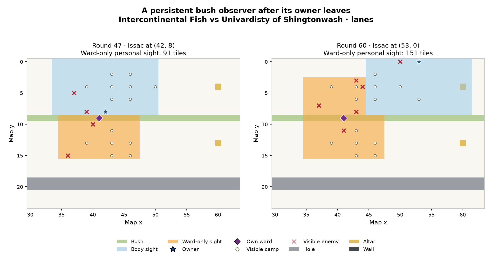
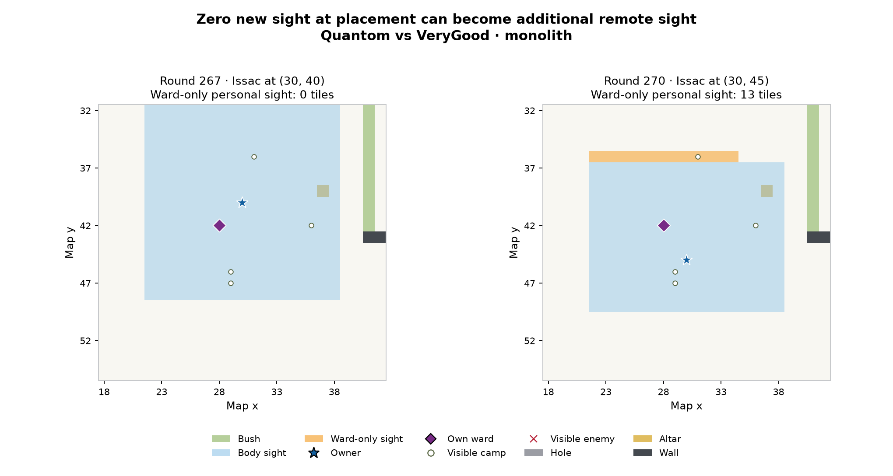

# Ward strategy research — 16 October 2026

[Operational tactics: Chapter 04](04-vision-and-information.md)

The recommended starting point is **mission-directed personal observation**: reveal a blind decision before committing, or preserve an observer that remains valuable after departure. Compare a replacement with the old observer being lost. Bushes, objectives and chokepoints are candidate features; none is an unconditional rule.

This report separates **official mechanics**, **observed elite behavior**, and **our original planned policy**. It does not claim to have proved globally optimal placement, inspected opponents' private code, or produced a stronger bot. No bot strategy is changed by this documentation.

## Scope and evidence

The ladder was frozen at **00:51:52 on 16 October 2026, Europe/Zagreb** (22:51:52 UTC on 15 October). Its first four teams were **Intercontinental Fish, Sneaky Bush Campers, Mite, and Univardisty of Shingtonwash**. Rank means rank at this snapshot, not at the time of every historical match.

- All ten public team histories were read to completion: **863 pages**, yielding **2,774 eligible top-10 versus top-10 series and 13,870 per-map API game IDs**.
- The detailed native replay cohort contains **3,766 game IDs**: **all 2,460 IDs from the current top four playing one another**, plus **1,306** other IDs selected as the latest two per remaining unordered team pair, map and ranked/unranked kind. Selection did not use winners, ward counts or attractive examples.
- Exact raw-replay hashing leaves **2,119 different replay streams**. Repeated streams are retained in the game-ID index but are not counted as independent new trajectories. No identical raw stream crosses ordered team pairs or map labels in this cohort. Different streams still need not represent different private bot versions or independent experiments.
- The cohort spans nine maps and **13 October 16:10 to 15 October 22:50 UTC** by creation time. It contains **1,137 ranked and 2,629 unranked IDs**. Both kinds are relevant; unranked is not excluded.
- Every selected bundle's CRC, extracted replay bytes, SHA-256 and match attribution were independently checked. All **27,740 API game sides have null version and null submission ID**. We cannot attribute a style to a particular private upload or assert a policy has stayed unchanged.
- Native analysis confirms **240,868 successful placements**, **223,351 replacements**, and **1,501,844 sampled later alive-owner snapshots** on the 2,119 streams. Placement masks and sampled later masks agree with the official personal-vision union; final observations agree with public API results. The audit reports zero missing streams, mask mismatches or attribution/final-result failures.

The later samples are the next owner round after placement and then every fifth round while the ward remains, sampled on alive owners' turns. They are **not every turn, every legal placement opportunity, or a time-weighted uptime estimate**. Placements per 100 rounds below use whole **game rounds per team appearance**, not alive champion turns. First-placement round is conditional on a team placing a ward. Replacement intervals are consecutive successful casts by the same body, not a prescribed cooldown.

All native game statistics report engine **0.0.1**, schema **2**. Exact visibility/edge-case experiments use official WASM SHA-256 `ce302dc6666ae43592f6936e572bc4baca92a345bff13ef7f986609ac666a0dc` and SDK/CLI **2.1.6**. The freshly read official vision article separately confirms the high-level current rules. This does not establish byte identity with every currently deployed server executable; preserve the recorded executable identity when reproducing edge cases.

**Audit correction:** A seek-to-start snapshot can still be in drafting, so its champion list is incomplete. Final body-appearance denominators use the full official API champion roster, with each native ward owner's body/name/team checked against it. Placement and mask observations already use full actor states; they were not changed. The initial camp roster and static terrain were independently checked against every replay's embedded map. This is a denominator correction, not a change in observed casts or geometry.

## What the leaders actually do

These tables count each different raw stream once, contributing one observation to each participating team. They describe the frozen cohort, not an estimate from independent randomized experiments.

### All ten teams

| Rank | Team | Streams | Mean placements/game | Median first ward round | Median replacement interval | Bush placements | Zero immediate extra sight |
|---|---|---|---|---|---|---|---|
| 1 | Intercontinental Fish | 567 | 30.9 | 18 | 30 | 100.0% | 0.0% |
| 2 | Sneaky Bush Campers | 380 | 22.4 | 30 | 26 | 100.0% | 0.0% |
| 3 | Mite | 1011 | 37.5 | 22 | 28 | 100.0% | 0.0% |
| 4 | Univardisty of Shingtonwash | 821 | 34.9 | 30 | 12 | 86.6% | 0.0% |
| 5 | VeryGood | 227 | 43.2 | 29 | 14 | 100.0% | 0.0% |
| 6 | ❤️Quantom❤️ | 264 | 287.9 | 1 | 3 | 3.1% | 71.3% |
| 7 | hello | 264 | 87.2 | 5 | 13 | 51.7% | 33.4% |
| 8 | Nyxius | 243 | 32.5 | 21 | 19 | 100.0% | 0.0% |
| 9 | geese geese go | 221 | 38.0 | 20 | 28 | 100.0% | 0.0% |
| 10 | Full Damage | 240 | 96.7 | 26 | 1 | 100.0% | 19.0% |

The first three teams place every observed ward in a bush, and typically keep it for tens of rounds between same-owner casts. Univardisty uses more floor placements and changes style across maps. Quantom casts far more often, largely outside bushes, while Full Damage often recasts within one round. **Frequency alone does not identify good placement.** None of these medians is a cooldown recommendation.

Zero immediate extra means no ward tiles beyond this owner's body sight and temporary reveals, at placement. It does not mean no later value. An all-bush pattern is compatible with exploiting occlusion, but does not establish private intent or prove every useful ward belongs in a bush.

### Strong versus strong: all current top-four head-to-head games

| Team | Distinct streams | Mean wards/game | Bush | Median first round | Median replacement interval | Median new tiles vs retained old ward | Median lost old tiles |
|---|---:|---:|---:|---:|---:|---:|---:|
| Intercontinental Fish | 437 | 31.1 | 100.0% | 18.0 | 30.0 | 56.0 | 97.0 |
| Sneaky Bush Campers | 221 | 18.2 | 100.0% | 28.0 | 27.0 | 56.0 | 85.0 |
| Mite | 839 | 38.5 | 100.0% | 22.0 | 28.0 | 56.0 | 94.0 |
| Univardisty of Shingtonwash | 659 | 36.8 | 87.7% | 28.0 | 12.0 | 42.0 | 41.0 |

These 2,460 match IDs contain 1,078 different raw streams. New/lost tile medians compare a placement with retaining the old ward at the same current owner position; they include first placements with no old ward as the baseline. They are spatial descriptors, not a value function. Fish's frequent loss of more old tiles than it gains is not a demonstrated error: some tiles matter more, and the next owner position may change the comparison.

### Does the pattern survive a more recent slice?

The timestamp-only latest-two-per-pair/map/kind sensitivity has 1,513 IDs and 1,174 raw streams. Restricted to top-four head-to-head play:

| Team | All h2h streams | Recent h2h streams | Bush: all → recent | Median interval: all → recent |
|---|---:|---:|---:|---:|
| Intercontinental Fish | 437 | 62 | 100.0% → 100.0% | 30.0 → 31.0 |
| Sneaky Bush Campers | 221 | 64 | 100.0% → 100.0% | 27.0 → 25.0 |
| Mite | 839 | 84 | 100.0% → 100.0% | 28.0 → 28.0 |
| Univardisty of Shingtonwash | 659 | 56 | 87.7% → 85.3% | 12.0 → 12.0 |

The main bush/interval traits persist. This reduces concern that the headline is only a large pile of old repeated matches; it still cannot identify the private current bot version.

### Persistent monitoring after movement

Sampling reads the first phase-10 state of an alive owner turn on the immediately following round after placement and subsequently whenever the game round is divisible by five, until replacement. Every sample reconstructs exact personal sight from official champion-design sight, the current owned ward, and transient round tile reveals, then compares it with the official personal vision buffer. Sampling does not enumerate every owner turn.

| Team | Valid later samples | Extra ward sight | Extra camp-spawn sight | Extra enemy-position sight | Ward more than 8 tiles away | Initial-zero placements later positive |
|---|---:|---:|---:|---:|---:|---:|
| Intercontinental Fish | 186,843 | 98.1% | 51.9% | 14.5% | 35.2% | 0 |
| Sneaky Bush Campers | 93,602 | 97.0% | 52.6% | 18.0% | 38.5% | 0 |
| Mite | 392,376 | 97.0% | 52.0% | 16.7% | 37.7% | 0 |
| Univardisty of Shingtonwash | 242,457 | 96.5% | 63.2% | 19.6% | 40.6% | 0 |
| VeryGood | 82,136 | 96.6% | 50.3% | 16.7% | 35.7% | 0 |
| ❤️Quantom❤️ | 136,921 | 38.6% | 7.9% | 2.4% | 0.9% | 13,593 |
| hello | 130,315 | 76.0% | 36.7% | 12.3% | 22.7% | 4,308 |
| Nyxius | 73,475 | 98.5% | 53.8% | 19.2% | 40.4% | 0 |
| geese geese go | 78,480 | 97.5% | 51.2% | 15.0% | 38.2% | 0 |
| Full Damage | 85,239 | 94.4% | 46.6% | 18.4% | 33.7% | 3,696 |

Camp coverage means the actual embedded map’s camp **spawn tiles**, including currently empty or respawning spawns. Enemy coverage uses actual live enemy tile positions filtered through the official ward mask; it establishes available geometric tile sight, not that the bot queried or consumed it. The same warning applies to camp information.

These are available sight opportunities, not a measure of information actually consumed or a causal advantage. In particular, Quantom has 13,593 initially zero-extra placements that later produce positive extra sight in a sampled owner turn. Raw immediate area alone would discard those opportunities.

### Map-by-map behavior

Each cell is median placements/game; median same-owner replacement interval; bush percentage. Counts are distinct raw streams. Differences in map layout, game duration, draft/body counts and opponent mixture remain confounded.

| Map | Intercontinental Fish | Sneaky Bush Campers | Mite | Univardisty |
|---|---|---|---|---|
| collision | 2.0; 70.0; 100.0% (n=55) | 0.0; 7.0; 100.0% (n=42) | 2.0; 139.0; 100.0% (n=73) | 0.0; —; 0.0% (n=65) |
| corners | 50.0; 42.0; 100.0% (n=80) | 20.0; 48.5; 100.0% (n=41) | 26.0; 61.0; 100.0% (n=156) | 3.0; 91.5; 14.5% (n=120) |
| elkring | 56.0; 33.0; 100.0% (n=73) | 24.5; 43.0; 100.0% (n=44) | 33.0; 49.0; 100.0% (n=157) | 46.0; 21.0; 82.9% (n=119) |
| expanse | 0.0; —; — (n=49) | 0.0; —; — (n=36) | 0.0; —; — (n=67) | 1.0; 200.5; 0.0% (n=63) |
| interlock | 16.0; 77.5; 100.0% (n=47) | 24.0; 56.0; 100.0% (n=44) | 20.0; 70.0; 100.0% (n=65) | 10.0; 95.5; 36.9% (n=64) |
| lanes | 53.0; 24.0; 100.0% (n=79) | 54.0; 18.0; 100.0% (n=45) | 69.0; 21.0; 100.0% (n=156) | 112.0; 9.0; 98.0% (n=122) |
| monolith | 11.0; 46.0; 100.0% (n=49) | 21.5; 39.0; 100.0% (n=42) | 35.0; 30.0; 100.0% (n=67) | 17.0; 49.0; 21.7% (n=58) |
| packs | 46.0; 21.0; 100.0% (n=74) | 35.5; 23.0; 100.0% (n=50) | 43.0; 24.0; 100.0% (n=156) | 52.5; 9.0; 97.0% (n=118) |
| rows | 48.0; 29.0; 100.0% (n=61) | 51.0; 7.0; 100.0% (n=36) | 58.0; 21.0; 100.0% (n=114) | 9.0; 51.0; 8.1% (n=92) |

The map contrast is substantial: all three of Fish/Sneaky/Mite have median zero casts on expanse, few on collision, and many on lanes, packs and rows. Univardisty is 98.0% bush on lanes but only 14.5% on corners and 8.1% on rows. This argues against a universal bush-only or fixed-interval prescription. The table itself does not isolate map geometry from draft size, routes, game length or opponents.

The actual embedded map data, checked across the entire native cohort, contains exactly one terrain hash per map name:

| Map | Size | Draft slots/team | Bush tiles | Wall tiles | Hole tiles |
|---|---|---|---|---|---|
| collision | 41×41 | 3 | 222 | 84 | 60 |
| corners | 71×71 | 5 | 60 | 44 | 84 |
| elkring | 30×30 | 5 | 36 | 0 | 36 |
| expanse | 80×80 | 3 | 0 | 224 | 16 |
| interlock | 40×40 | 4 | 38 | 76 | 16 |
| lanes | 90×30 | 5 | 144 | 0 | 76 |
| monolith | 50×50 | 5 | 66 | 98 | 0 |
| packs | 31×31 | 3 | 62 | 0 | 0 |
| rows | 50×50 | 4 | 142 | 214 | 0 |

Draft slots are not body counts: choosing Cassi & Issac adds the second controlled body. The figures are full-map geometry descriptors; they do not identify which routes the bots took.

**Our feature-based interpretation and proposed response:**

- **Lanes:** a long rectangular map with a connected bush structure makes cross-bush observation relevant; the Fish example demonstrates that mechanism directly. Choose the bush position whose actual mask watches the current approach and next region, not simply the tile farthest forward.
- **Packs and elkring:** small maps with no walls still have bush occlusion. A bush ward can reveal a concealed fight or resource approach, but a floor ward does not extend radius-8 open sight immediately. Use the personal view before committing to a camp and preserve useful off-path monitoring afterward.
- **Corners:** large area and sparse bushes favor asking which particular crossing or future job a camera serves. The leaders' longer observed retention intervals are compatible with persistent monitoring; they do not prove a fixed timer is best. Univardisty's floor-heavy alternative remains a reason to evaluate exact masks rather than enforce a bush-only rule.
- **Interlock, monolith and rows:** wall shadows, branching routes and separate bush regions make connectivity and which side of an obstruction is observed more important than distance to the objective. A ward can be thrown across a nearby wall; verify that the other side actually watches a relevant branch. Holes affect travel time without blocking sight, so a long path around a hole is not automatically an unseen path.
- **Expanse:** no bushes does **not** mean no possible ward value. The three all-bush teams make no observed placements here, but 224 wall tiles still permit occlusion-related jobs, and an open observer can retain information after departure. This is an original opportunity to test rather than a proven mistake by the leaders.
- **Collision:** it has many bush tiles but very few median placements for several leaders. Bush quantity alone is not a sufficient explanation of use. Scouting competes with immediate decisions along the actual route; the three-slot draft and route/game mixtures also differ.

On an unseen map, use these features and the actual mission graph; never require its name to be in this table.

### Who wards, and what happens nearby in time?

The attached champion-body CSV counts each champion body’s game appearance, bodies that ever placed, and placements; tactical role assignments are not exposed. Complete body denominators use the official API final champion roster because an initial native snapshot can still be during drafting. Every native ward actor’s name and team was checked against that roster. Cassi and Issac have separate body denominators and personal wards. A deployment percentage is per observed body appearance, not per legal opportunity.

| Team | Ward-bearing bodies / body appearances | Same-round move | Same-round basic attack | Same-round cast | Submit command within 3 rounds | Recall command within 3 rounds |
|---|---:|---:|---:|---:|---:|---:|
| Intercontinental Fish | 2244/2938 | 99.3% | 6.5% | 13.1% | 6.5% | 1.4% |
| Sneaky Bush Campers | 1160/1876 | 85.1% | 6.8% | 8.0% | 12.7% | 3.9% |
| Mite | 4821/5295 | 97.8% | 6.3% | 8.7% | 9.8% | 3.0% |
| Univardisty of Shingtonwash | 3099/4037 | 74.8% | 8.1% | 12.5% | 5.0% | 2.1% |
| VeryGood | 1034/1176 | 86.5% | 5.7% | 8.1% | 4.2% | 2.9% |
| ❤️Quantom❤️ | 945/1233 | 83.2% | 7.1% | 8.7% | 5.7% | 4.3% |
| hello | 1308/1321 | 82.5% | 16.5% | 9.7% | 3.9% | 1.8% |
| Nyxius | 1001/1196 | 99.2% | 4.4% | 9.3% | 5.1% | 2.5% |
| geese geese go | 954/1087 | 84.5% | 11.6% | 12.1% | 5.6% | 2.7% |
| Full Damage | 951/1153 | 92.5% | 4.3% | 7.5% | 5.2% | 4.1% |

These are native recorded command associations around a confirmed ward placement. The other command’s success or damage result is not independently established here. A submit/recall command is not evidence of completion or of why the ward was placed. The scanner does not infer a camp capture plan, choke definition, combat avoidance, or a lost action from distance alone.

These body appearances come from the complete official roster, including the separate Cassi/Issac bodies and variable team sizes across maps. The full per-body-type counts are in `current-champion-bodies.csv` inside the evidence archive. For example, Fish's common bodies all contribute: Ren 3,482 casts, Stellar 2,689, Cassi 2,751, Issac 3,281, Ryth 2,298 and Varg 2,702. There is no evidence for importing a single LoL-support-only ward responsibility.

### What do the cameras cover?

| Team | Ward covers a camp spawn | Ward covers altar | Adds new camp-spawn sight vs old | Adds new altar sight vs old | Carrying gems when placing | Replacements lose more tiles than gained |
|---|---:|---:|---:|---:|---:|---:|
| Intercontinental Fish | 73.8% | 38.9% | 33.9% | 20.2% | 27.7% | 93.3% |
| Sneaky Bush Campers | 61.2% | 58.6% | 28.2% | 20.1% | 28.2% | 88.0% |
| Mite | 63.1% | 49.4% | 25.4% | 27.5% | 24.9% | 92.7% |
| Univardisty of Shingtonwash | 74.7% | 41.5% | 47.3% | 24.3% | 28.5% | 62.5% |
| VeryGood | 65.8% | 51.4% | 23.7% | 19.1% | 18.0% | 92.3% |
| ❤️Quantom❤️ | 76.1% | 34.8% | 3.9% | 3.0% | 38.9% | 40.5% |
| hello | 86.1% | 38.8% | 12.1% | 10.4% | 27.9% | 70.9% |
| Nyxius | 71.3% | 48.5% | 27.3% | 20.2% | 35.1% | 56.8% |
| geese geese go | 74.1% | 40.5% | 36.3% | 19.2% | 24.8% | 92.0% |
| Full Damage | 70.4% | 46.3% | 14.5% | 8.0% | 21.8% | 50.6% |

Losing more old tiles than new ones is a spatial tradeoff, not evidence of a bad placement: tile counts do not encode which information mattered or how long it remained relevant. Base and nearest-objective distances are available in per-placement files; “choke” and enemy-territory labels were not guessed from map names.

Covering a camp spawn is useful only if current lifecycle/resource information changes a decision. Covering an altar is useful only if approach information arrives before danger, not simply because its tile falls in a mask. Complete ordered-draft summaries are preserved in the machine-readable evidence; their differences are observational and do not establish a ward-specific champion advantage.

## Why these placements can matter

### Immediate occlusion versus persistent observation

Every queried current champion body type has radius-8 natural sight. A legal ward center is at most 2 tiles away and has radius-6 sight. In unobstructed terrain, the triangle inequality gives `distance(owner, ward tile) <= 2 + 6 = 8`: a new ward cannot immediately extend the owner's open-field view. It can immediately bypass a wall or bush shadow, and it can become a remote camera when the owner moves away.

This distinction prevents two mistakes: rejecting an open ward because it initially adds zero tiles, and calling a bush ward useful merely because it reveals a large area. Information must concern a decision, and it must arrive early enough to change that decision.

### Exact example: Fish's camera persists after departure

In **Intercontinental Fish versus Univardisty, lanes**, [series and replay](https://2026a.battlecode.co.uk/game/match-groups/0e462911-7cde-42ba-a50c-d4554ff4266e), per-map game `4b5c61db-a064-4459-bc95-31150aa96347`, Issac places a bush ward at **(41,9), round 47**, from **(42,8)**. At placement it adds **91 tiles** beyond that owner's body/temporary-reveal sight. At **round 60**, Issac is at **(53,0)** while the same ward adds **151 tiles** of remote personal view. This is observed persistence, not an inference that the bot deliberately planned this exact information job or won because of it.

The plot uses native coordinates, with y increasing downwards. Blue is body sight; amber is the ward contribution beyond body sight and temporary reveals. Static map terrain is shown for context; only owner-visible camps and enemies are drawn. Different red crosses across frames are not presented as tracked identities or a causal response.

### Counterexample to an immediate-area-only score

In **Quantom versus VeryGood, monolith**, [series and replay](https://2026a.battlecode.co.uk/game/match-groups/0c23558a-9aa4-441b-b161-050031ddde11), per-map game `b9b40d5e-dacc-443a-af00-b4e571359090`, Issac places on ordinary floor at **(28,42), round 267**, while at **(30,40)**. Immediate extra sight is exactly **zero**. By **round 270**, after the owner moves to **(30,45)**, the retained ward supplies **13 additional tiles**. This proves the immediate-only scoring failure mode; it does not prove this particular camera changed a useful decision.

### Additional strong-versus-strong cases

- **Sneaky Bush Campers versus Fish, corners** — [series and replay](https://2026a.battlecode.co.uk/game/match-groups/958f2867-cc7c-4dab-abe8-16c2d220ee26), per-map ID `9c830c09-e7bf-4032-ad35-4cadfac6c49f`: ward placement in round 39, retained into the sampled owner turn in round 110; extra personal tiles **67 → 169**. The next recorded command is a slot-1 cast on round 110.
- **Mite versus Fish, corners** — [series and replay](https://2026a.battlecode.co.uk/game/match-groups/68cc9c67-5cc5-4db4-8de9-7a72f5f6d0bd), per-map ID `91d5f3ea-af9d-4831-9dc2-5e36cb3a9b74`: ward placement in round 25, retained into the sampled owner turn in round 100; extra personal tiles **67 → 169**. The later exact mask contains enemy positions outside body sight.
- **Univardisty versus Mite, elkring** — [series and replay](https://2026a.battlecode.co.uk/game/match-groups/60d70887-26f4-47bb-a6b2-7b7440359ef5), per-map ID `7259213a-b026-4ee3-a974-1f82b0b71cde`: ward placement in round 33, retained into the sampled owner turn in round 135; extra personal tiles **90 → 169**. The next recorded move is on round 136.

These deliberately illustrate geometry and recorded sequences. A subsequent command is not proof the private bot used the ward information or that the command succeeded. The archive includes exact original and later frames for the illustrated plots, Sneaky and Univardisty cases. The compact Mite case preserves the audited placement and later observation records, counts, enemy positions and source hashes; it does not include full later tile-mask arrays.

## Mechanics that change the strategic answer

The [official vision article](https://2026a.battlecode.co.uk/game/docs/vision) confirms personal sight, permanent free wards, no damage, one active ward per champion and replacement once per round. The SDK and controlled engine probes additionally establish:

| Fact | Consequence for our policy |
|---|---|
| A successful new ward removes the owner's old one. | Replacement costs the old remote observation point, even though it costs no gold. |
| Placement uses a trinket charge, not movement, basic attack or ability-cast allowance. | Reveal/re-query/decide can occur before movement or combat. Do not always wait until the end of the turn. |
| Timer ticks at owner turn end; charge restores at next owner turn start. | Check every owner turn, but do not confuse availability with a reason to replace. There is no LoL-style multi-round refill stockpile. |
| Placement can target unseen legal terrain across a wall within 2 tiles. | A controlled corner/bush check can avoid a blind face-check. Re-query immediately after success. |
| Walls, holes, altars, enemy spawns and known allied-ward tiles are invalid; champion/camp/TP-reservation occupancy alone is legal. | Do not discard useful bush candidates just because a unit or camp occupies them. A ward beside an altar may watch it; a ward cannot be put on the altar. |
| A hidden allied-ward collision returns false, reveals its tile and preserves charge; known invalid placement throws. | Handle both outcomes, record the rejected tile, and avoid a retry loop. This is not a license to assume unseen allied wards are absent. |
| Sight is terrain-aware shadowcasting. From its origin bush a ward sees across that connected bush, subject to range/walls, not through separate bushes. Holes do not occlude sight. | Use exact hypothetical masks and connected regions, not a distance-to-bush or circular-radius proxy. |
| Wards survive recall and death; a dead body still has turns and its remote sight. | A relevant watcher can continue supplying information during recovery; preserve it and continue useful reporting when possible. |
| Cassi and Issac each own a ward and separate personal sight. | The pair supplies two observers, not an automatically shared camera or one pooled charge. |
| A ward cannot capture a cleared camp and does not block normal movement. | It can monitor a resource, but cannot replace the champion required to secure it. |
| Ordinary wards are invulnerable; legacy control wards are not purchasable in the audited runtime. | Do not import ward-clearing, sweeper, ward-defense, expiry-refresh or purchased-control-ward routines from LoL. |
| Each team's live shared memory is only 8 bytes. | Allocate observers and alerts explicitly; there is no global team-vision union. Seeing an ally's ward object does not grant its pixels. |

The public ward snapshot does not identify a visible enemy ward's owner. Its presence may suggest enemy observation but cannot establish which opposing champion can currently use that camera. A message from an ally also does not make an otherwise hidden unit a legal target.

## What transfers from professional LoL

The transfer is a way of choosing information, not Summoner's Rift ward coordinates or numeric timers.

| Sourced principle | Battlecode adaptation | Limit |
|---|---|---|
| CoreJJ's published lesson outline emphasizes a purpose for each ward and avoiding redundant coverage. | Name a mission: reveal a blind decision, watch a threatened approach, monitor a return route, or distinguish enemy rotations. | The accessible source is the publisher's outline, not a watched video transcript. Redundancy is owner-specific here. [CoreJJ / Aimlabs](https://aimlabs.com/courses/7IeultcsJG4RYIS6L8tPtc/lessons/5l7CZgA2IMDhmclKh3Yaxt). |
| Mikyx's firsthand guide emphasizes earlier warning from deeper sight, safe deployment and watching objective approaches. | Prefer a relevant entrance that gives reaction time; use already-safe travel to improve the observer. | Deeper is not automatically better. Throw range is 2, and a scouting detour can lose health, time or gems. [Mikyx / Red Bull, 28 November 2024](https://www.redbull.com/sg-en/league-of-legends-how-to-ward). |
| Dignitas' original 2016 Worlds analysis distinguishes vision quantity from efficient route coverage and describes shifting observation with controlled territory. | Watch region transitions and several plausible routes; move the observer when the team's operating region changes. | Historical analysis, not a controlled study or current LoL mechanics reference. In Battlecode teammates need explicit reports. [Dignitas, 5 October 2016](https://dignitas.gg/articles/blogs/Unknown/10280/transitioning-lane-priority-into-tempo-and-vision-control). |
| Riot describes vision as enabling plays and preserving information choices. | Measure the movement, target, farm, retreat or channel decision enabled by a sighting. | Design rationale does not validate our heuristic. [Riot 26.1 design notes, 7 January 2026](https://www.leagueoflegends.com/en-us/news/game-updates/patch-26-1-notes/). |

We explicitly **do not** transfer shared team pixels, support-only responsibility, a purchased ward economy, expiring wards, denial by clearing, a recall-to-refill schedule, lane/tower geometry or fixed real-time objective setup intervals. Another champion can report a ward sighting; it cannot lend direct sight. Persistent observation after departure is more central here than LoL's expiry/replacement cycle.

## Our original strategy, beyond copying the leaders

### Choose information by the next commitment

The operational rules are in [04.1](04-vision-and-information.md#1-ward-placement). Before a blind route choice or commitment, ask what observation could change it. If the answer is immediate bush/corner information, deploy before that decision and re-plan. Otherwise consider a future watcher along the route or a camera worth retaining after departure.

For an unfamiliar map, derive candidate jobs from its actual walkable regions, bush components, walls, camp approaches, selected altar route and likely enemy transitions. Do not branch on a map name or copy a coordinate from one of the examples above. The watcher should see the **approach to a danger**, with time to react, rather than only the final point where the enemy can already attack or interrupt.

### Compare future keep-versus-replace states

Predict a small set of meaningful owner positions: the next move/fork, the camp hold, departure, the retreat/banking route and the post-recall state when relevant. For each state evaluate the old and proposed ward against the **same natural owner-vision baseline**. Score relevant warnings and decisions, not raw pixels alone. Preserve old off-path coverage when it still matters. A nearby ally's mask is not part of this owner's baseline.

This catches an opportunity the observed bush preference alone cannot express: an open-field ward with zero gain now may be a valuable remote approach watcher after recall. It also avoids a weakness of always-forward placement: removing a useful rear camera just as the owner leaves its region.

### Give the observation a consumer

After revealing a hostile bush, re-evaluate route and legal targeting before spending actions. Before farming, use the view to reconsider the camp/fight/retreat choice. During a bank trip or recovery, use a persistent watcher to retain fresh camp or rotation information. When the relevant decision belongs to another body, send a prioritized timestamped alert under an agreed protocol.

The team memory is already allocated. A new protocol must preserve camp claims or explicitly migrate them; eight bytes are not an unused enemy-location database. Dead bodies can still be useful observers, but only fresh reports and actual reader decisions demonstrate team value.

### Frequency is event-driven

Do not copy a median elite interval as an optimal cooldown. Cheap checks happen every owner turn; expensive rescoring is triggered by changed missions, new sight, a fork, departure or changed enemy routes. Keep the camera on ties. Place again when the new job is more useful than the job being relinquished. No expiry refresh is needed, and repeated casts at one coordinate do not renew a lifetime.

## Our existing bot

The audited cleaned study27 combat derivative is commit [`e72cec84391cf0623d15c2eb3f2f864e2b0bddea`](https://github.com/Javiops/Cambridge-Battlecode-2026/commit/e72cec84391cf0623d15c2eb3f2f864e2b0bddea). `P_R5_WARD` is **0**, so the ward helper is dormant. The helper runs late if enabled, considers bushes near the owner, scores geometric progress toward a coarse goal, and uses four/eight-round recheck intervals. It has no exact future personal-visibility score, old-versus-new mission comparison or new-information decision pass.

The older study26 note records 55 maps won on both sides versus 58 lost on both sides for a specific ward experiment against a specific prior bot. That is not evidence that all ward strategies fail. The proposed chapter is **Planned**, and merely setting the old flag to 1 would not implement it.

## What to implement and measure next

Keep the next change bounded rather than implementing an elaborate belief model at once:

1. Make ward observations usable at the decision point: legal pre-move/pre-commit placement, re-query and re-plan. Retain all current movement/combat/channel restrictions.
2. Compare a simple mission-aware camera with retaining the old one, including next-step and post-departure masks. Log reasons for keeping, placing and skipping. Add strategic team alerts only after a compatible shared-memory design exists.
3. Measure information consumed: new visible enemy/camp state, how early a relevant threat is seen, changed movement/target/farm/channel decisions, old coverage lost, fuel and illegal/failed attempts. A cast or a large mask alone is not success.
4. Compare no ward, the old bush helper, frequent always-forward placement, maximum-immediate-area placement and the mission policy. Test timing and placement both separately and together, because a useful camera with no consuming decision can look ineffective. Use several opponents and unseen generated maps before claiming improvement.

Weights, planning horizon, response-time model and switching margin are unresolved experimental parameters. Elite observations motivate the hypotheses but cannot determine these parameters or a causal win-rate benefit. No strategy match tests or bot upload were performed in this research task.

## Sources and reproducibility

- [Official vision and ward rules](https://2026a.battlecode.co.uk/game/docs/vision), [Bot API](https://2026a.battlecode.co.uk/game/api), [shared memory](https://2026a.battlecode.co.uk/game/docs/shared-memory), and the [frozen ladder source](https://2026a.battlecode.co.uk/api/v1/ladder).
- [Evidence archive](ward-evidence-2026-10-16.zip): cohort and summary audits; full descriptive JSON/CSV tables; a compact index of every selected match, raw hash and public bundle URL; exact illustrated case frames; source/probe notes and analysis scripts. Its README and manifest distinguish included material from the full local per-placement traces.
- Each match's native source bundle is public at `https://2026a.battlecode.co.uk/api/v1/matches/<match-id>/bundle`. The archive's index records all 3,766 match-ID bindings and 2,119 raw hashes, so the underlying source can be retrieved and rechecked.
- Mechanics edge cases are recorded with their official SDK/WASM source identities. They are controlled API fixtures, not bot strategy match tests. The live high-level vision text was independently re-read during this task.
- No opponents' private bot source is included or claimed to be known. The empirical corpus is public results and replays. Our own source audit is tied to the named commit, and all intended behavior remains **Planned**.

The evidence distinguishes repeated game-ID appearances from different raw trajectories; both are descriptive. A public result or spectator frame does not reveal private code, intent, team communication, unseen legal alternatives or why a game was won. Later vision is sampled and end-of-game truncates camera histories. Those limits apply to every recommendation above.
